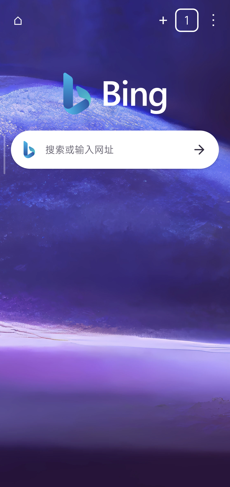
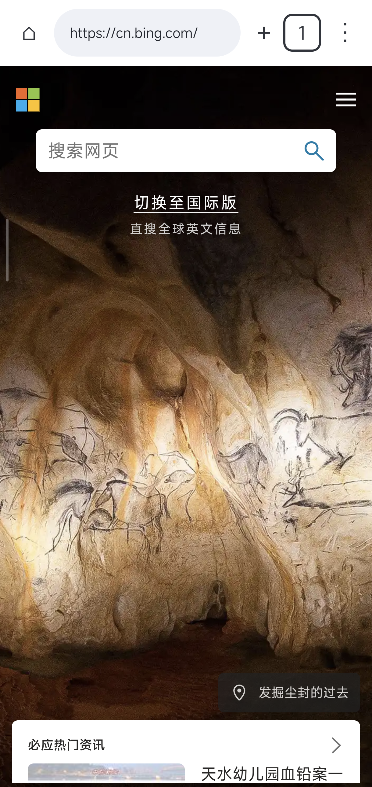
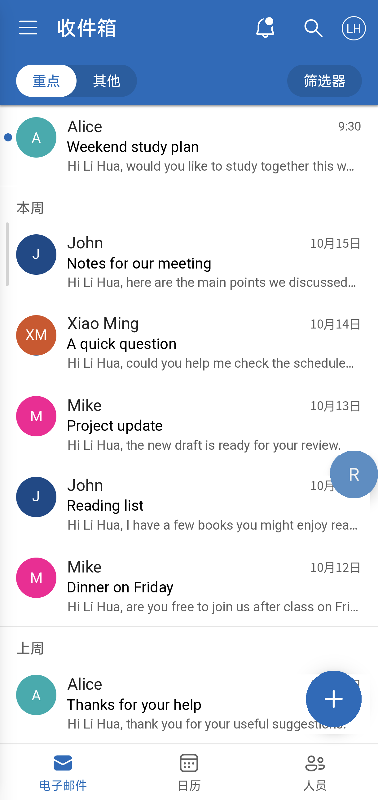
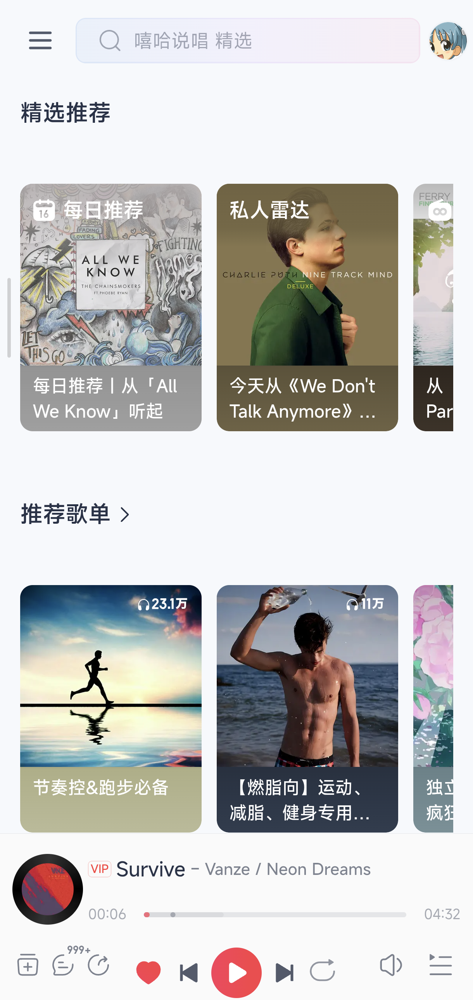
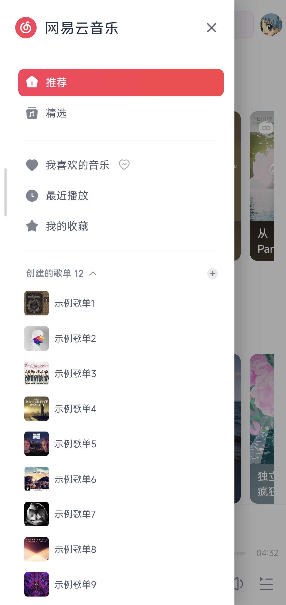
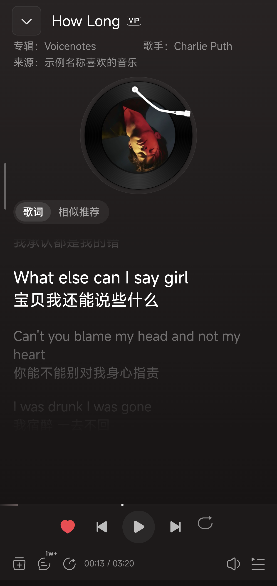

# ReBrowser

**ReBrowser** 是一个**实验性项目**，依赖于安卓系统webview组件，提供了一个**轻量级浏览器环境**，同时提供了两个实例性基于网页的子应用**Reoutlook和Remusic**.

[下载 v1.0.5](https://github.com/13513208952/ReBrowser/releases/tag/v1.0.5) · [开始使用](#开始使用) · [项目定位](docs/PROJECT_VISION.md) · [文档目录](docs/README.md)

Rebrowser的“子应用”是基于**网页即应用**的理念，对网页进行重新包装和针对性代码工作，使其最终以应用的形态展现。目前总共有**2个子应用**可用，分别是**ReOutlook和ReMusic**.

| 子应用 | 详情 |
| --- | --- |
| **ReOutlook · 邮件** | Outlook邮箱网页版，可快速查看邮箱，额外提供了备份和导出记录功能 |
| **ReMusic · 音乐** | 网易云音乐webplayer重包装版，针对手机等竖屏形态进行了重新适配，并且可以与安卓系统联动 |

**极简包**仅含Rebrowser浏览器功能本体，**全量包**额外含有全部子应用，极简包额外提供了去掉背景照片的轻量版本。

## 界面与实践

以下为 **v1.0.4 手机实机界面**，并进行了一定的隐私处理。

### ReBrowser：

基于安卓webview的**轻量化浏览器**，具备较为严格的安全设计，可以**自动拦截应用跳转行为**并**阻止多种未授权下载行为**。

  
  

### ReOutlook：

官方 Outlook 会话负责在线业务，ReOutlook 结合**结构化同步、本机邮件缓存和离线阅读**等功能，改善outlook官方web端在安卓竖屏设备上的体验。

  

> 图片进行了隐私处理。

### ReMusic：

基于网易云音乐webplayer,对界面进行针对性代码工作和包装，优化了其在**安卓竖屏设备上的使用体验**，并进行了**与安卓系统播放器控件联动**的相关工作，为安卓设备在常规app以外提供了一种**轻量化替代方案**。

> 本项目**没有提供绕过网易云音乐会员权益校验等非法功能**。

  
  
  

> 依次为**推荐页、歌单侧栏、完整播放器与歌词**。头像、私人歌单名及来源用户名已进行隐私处理，其余内容保留实机显示；。示例头像的作者、许可与处理方式见[资源说明](docs/ASSET_CREDITS.md#remusic示例头像)。

**截图用于展示界面**，不代表所有设备、窗口形态或服务权益均已验证。[当前实现与已知限制](docs/PROJECT_STATUS.md)。

## 下载与安装

当前正式版本：**[v1.0.5](https://github.com/13513208952/ReBrowser/releases/tag/v1.0.5)**。从 [GitHub Releases](https://github.com/13513208952/ReBrowser/releases) 下载，使用 [SHA256SUMS.txt](https://github.com/13513208952/ReBrowser/releases/download/v1.0.5/SHA256SUMS.txt) 校验。

| 套件 | 内容 | 下载 |
| --- | --- | --- |
| **极简无背景** | 仅 ReBrowser，纯白新标签页，约 220 KB | [APK](https://github.com/13513208952/ReBrowser/releases/download/v1.0.5/ReBrowser-v1.0.5-minimal-lite.apk) |
| **极简有背景** | 仅 ReBrowser，包含蓝紫背景照片，约 1.07 MB | [APK](https://github.com/13513208952/ReBrowser/releases/download/v1.0.5/ReBrowser-v1.0.5-minimal-background.apk) |
| **全量有背景** | ReBrowser、ReOutlook、ReMusic，约 1.15 MB | [APK](https://github.com/13513208952/ReBrowser/releases/download/v1.0.5/ReBrowser-v1.0.5-full-background.apk) |

**使用 ReOutlook 或 ReMusic，请选择全量包。** 子应用在设置中主动启用或进入，不需要另装 APK。

### 运行要求与升级

- **Android 10 或更高版本**。浏览器和其他子应用分别对安卓环境依赖有不同的要求，部分设备上可能功能不完整或不可用，建议使用较高安卓版本的设备安装使用。
- **三包同安装身份，不能并装。升级只覆盖安装，不卸载、不清数据。** 极简可覆盖升级到全量；安装新版全量后，普通安装器不能回退极简或较低版本码的旧包。
- 升级保留既有背景和近期访问选择。无背景包不含照片；历史为空时不显示近期访问。重要的临时浏览环境请先上锁，避免进程重启后丢失。

v1.0.5 新增 ReOutlook／ReMusic 独立设置、缓存与全部本机数据的分别清理，以及支持情况下的当前网站部分存储估算。详细变化和验证范围见[本版发布记录](docs/releases/v1.0.5.md)。

## 开始使用

- **浏览**：打开 ReBrowser，在新标签页输入网址或搜索。可以在设置界面选择 Bing、百度、Google 或 DuckDuckGo作为默认搜索引擎。
- **管理环境**：总标签页是独立浏览环境，子标签页共享所在环境的登录状态。新总标签页默认临时，需要长期保留时请**主动上锁提升为副标签页**。

  当**副标签页**被提升为**主标签页**时，浏览器会尽可能保持这个标签页处于打开状态，**副标签页**则不会阻止关闭但是仍然会长期保留数据，**临时标签页**不会长期保留数据。

  > **tips**:出于控制应用在长期使用中的体积占用等目的，**默认不会长期保存数据**，请在需要时在标签页管理界面将“**临时标签页**”上锁为“**副标签页**”来防止信息丢失。

- **邮件**：全量包打开 **设置 → 应用管理 → ReOutlook → 进入**。也可开启独立桌面入口；新安装默认隐藏邮件入口，升级保留原选择。
- **ReMusic**：全量包在 **设置 → 应用管理 → 音乐** 主动启用。启用与独立图标绑定，完成官方登录后进入 WebPlayer；新运行时默认暂停，继续播放需要明确操作。
- **默认浏览器**：点击后进入安卓系统默认浏览器设置界面，可以自行设置包括Rebrowser在内的任何一个系统已有的浏览器。

  > **tips**:为了您的日常使用体验，我们建议使用chrome,edge,firefox等浏览器。本项目的浏览器功能**仅适用于查看新闻等日常用途**，自动拦截等相关功能部分情况下会影响网页正常工作。

详细操作：[ReBrowser 指南](docs/user/REBROWSER.md) · [ReOutlook 指南](docs/user/REOUTLOOK.md) · [ReMusic 指南](docs/user/MUSIC.md)。

## 其他说明

ReBrowser 当前是基于系统 WebView 的 Android 应用，不是新的操作系统，也不宣称包含完整桌面 Chromium 或能自动适配任意网站。[完整项目定位](docs/PROJECT_VISION.md)。

项目**尚未接受独立安全审计**，不保证每家 WebView 或每个网站都兼容。为兼容旧版覆盖升级，公开包沿用历史 Android Debug 证书，APK 本身是非调试 Release 构建。详见[隐私说明](PRIVACY.md)、[安全策略](SECURITY.md)与[已知限制](docs/PROJECT_STATUS.md)。

## 反馈与更多资料

遇到问题可在 [Issues](https://github.com/13513208952/ReBrowser/issues) 反馈，请描述设备、Android／WebView 版本和复现步骤；不要公开真实邮件、密码、登录令牌或私钥。

[文档目录](docs/README.md) · [项目状态](docs/PROJECT_STATUS.md) · [开发参考](docs/DEVELOPMENT.md) · [仓库维护](docs/MAINTENANCE.md) · [发布记录](docs/releases/README.md)

项目代码采用 [GPL-3.0](LICENSE)。第三方界面、名称、商标、封面、歌词及示例头像保留各自权利与许可；本项目与相关服务及品牌方没有隶属或官方合作关系，详见[资源来源](docs/ASSET_CREDITS.md)。
