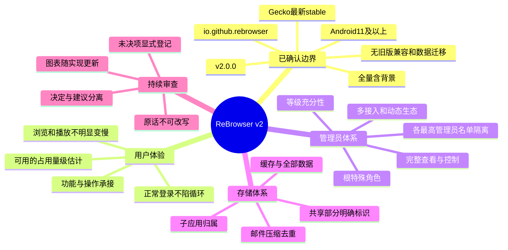

# GeckoView v2 · 规划与技术验证工作台 R10

> **已按O26恢复并调整任务顺序。** 子应用占用查看/清理暂搁置；先技术验证，再构建应用本体全代码总树。O28要求保存后继续，不是暂停。[O25暂停快照](PAUSED_REVIEW.md)仅作历史记录。
>
> 当前：[应用本体目标代码总树](APPLICATION_CODE_TREE.md)／[全代码清单](records/application-code-files.json)／[技术验证状态](records/technology-validation.json)。已验证二进制、API编译和隔离R8 Release样机打包，**未运行Android/官网/真实播放测试**；树中未实证细节明确标记，不能据此宣称全部规划或实现完成。

> 状态：**整体规划未完成**。需求基线、图谱与部分领域蓝图已建立；按16领域继续补齐可实施设计。普通工程选择由助手研究决定。产品代码、密钥生成、设备登记、安装与发行均未开始。

| 视图 | 用途 | 权威输入 |
| --- | --- | --- |
| [应用本体代码总树](APPLICATION_CODE_TREE.md) | 主树展开全部目标运行代码文件，数量由清单校验；测试等辅助只概括引用 | O26／O27，首版设计非产品代码 |
| [动作到本体文件路由](records/application-action-routing.json) | 178动作逐项指向目标领域代码；延期动作不伪造当前实现 | 不以UI Activity替代领域服务 |
| [主树文件权威清单](records/application-code-files.json) | 逐路径/职责/技术证据/辅助测试关联 | 不把测试/工具混入本体叶节点 |
| [技术验证状态](records/technology-validation.json) | Artifact/compile/Release包/Android运行分级；存储功能搁置 | 隔离验证，不触日常应用资料 |
| [完整性看板](views/10-completeness-board.md) | 逐领域缺口、完成标准和推进次序；不把图表数量当完成 | O17／O18、完整性账本 |
| [系统与体验](views/01-system-and-parity.md) | 组件、会话、能力边界 | R01–R10、功能矩阵 |
| [管理员权限](views/02-authority.md) | 根／最高管理员／名单关系、等级表达式、授权流程 | R10–R20、authority-model |
| [接入与生态](views/03-entrypoints-and-plugins.md) | 有线／无线／应用内／跨应用／动态介入 | R18–R20、接入矩阵 |
| [存储与清理](views/04-storage.md) | 归属、估计口径、删除状态机、API缺口 | R22–R25、E01–E05 |
| [邮件与登录](views/05-mail-and-auth.md) | AAD／MSA流程、压缩、去重、检索 | R21、R24、历史问题 |
| [签名与发行](views/06-trust-and-release.md) | 密钥分域、旧根保全、依赖／R8／加密性能 | R07–R09、R28–R30 |
| [高级静态准入](views/08-compiled-administrators.md) | 仅APK新增高级身份、严格禁用关系、不可禁用根 | R13、R31、R32、R35 |
| [可信来源与数据](views/09-root-continuity-and-data.md) | 四步确认、两次系统验证、A→异常B→正常C保持可信源、销毁后解锁 | R33、R34、R36–R38 |
| [实施与验收](views/07-roadmap-and-review.md) | 依赖图、审查闸门、验收矩阵 | P0–P7、测试／风险表 |
| [运行时与会话蓝图](views/11-gecko-runtime-sessions.md) | 单runtime候选、session/context所有权、Popup与崩溃契约 | A02／A05、E07–E10 |
| [浏览器与系统边界](views/12-browser-and-system-boundaries.md) | 正常/失败动作、下载流、权限、Popup、返回与系统交接 | A03／A04 |
| [控制协议契约](views/13-control-protocol-contract.md) | 持钥接入、包络、幂等、异步结果、跨应用与扩展边界 | A05／A10 |
| [邮件详细初稿](views/14-outlook-offline-design.md) | 登录、实体、压缩容器、事务、检索与离线阅读 | A06／A07 |
| [音乐原生分工初稿](views/15-music-engine-native-design.md) | 官网SDK/Gecko/Android媒体分工、状态与旧补丁取舍 | A08 |
| [资源与依赖初稿](views/16-resources-and-dependencies.md) | 线程/队列/预算及量测、工具链和依赖准入 | A13／A14 |
| [本轮集成契约核对](views/17-gecko-contract-review.md) | 已核实的回调/生命周期/媒体/存储候选及明确下一步，避免无边界阅读 | E14–E27、GC01–GC12 |
| [Gecko集成契约](records/gecko-contracts.json) | 12项来源已审/运行未验的实际约束与失败边界 | 固定stable源码 |
| [集成验证场景](matrices/gecko-contract-cases.csv) | 28项具体场景；全部planned-not-run | GC01–GC12 |
| [领域/连接器契约](views/18-domain-and-connector-contracts.md) | 模块输入输出、消息/流、真实任务与持久化轴、安全停止通道 | R7规范与时序例子 |
| [用户旅程/返回](views/19-user-journeys-and-back.md) | 首装/浏览/子应用/后台/设置和Back优先级 | 18条设计旅程 |
| [领域接口](records/domain-interfaces.json) | 10个逻辑组件45个方法，不要求拆成Gradle模块 | 明确所有权/线程/能力覆盖 |
| [连接器协议](records/connector-protocol.json) | 消息/流信用/租约/通道预算的权威定义 | 不等于管理员证明协议 |
| [动作语义与类型](records/action-semantics.json)／[参数DTO](records/domain-payloads.json) | 首批13动作的字段/完成/重试；其余动作仍待补 | 不是全功能注册表完成 |
| [任务时序例子](records/runtime-traces.json)／[离线演算器](review_runtime_design.py) | 超时不释放、旧结果结算、独立停止、静默及持久化 | 纯设计模型，非Gecko实测 |
| [邮件存储与合成基线](views/20-mail-storage-and-codec-evidence.md) | 小对象内联/大对象文件、codec/去重/事务；已做合成主机实验，不是Android性能 | A07、R8设计与原始结果 |
| [邮件存储设计](records/mail-storage-design.json)／[主机实测结果](evidence/mail-codec-host-baseline.json) | 同账户对象/表/索引/回收；Deflate/GZIP与可选既有主机Zstd对照 | 未加入产品依赖/未用真实邮箱 |
| [领域设计工作包](matrices/design-backlog.csv) | 16个工作包及真实欠缺项，不是已完成任务清单 | 完整性账本 |
| [完整性账本](records/completeness.json) | 每领域状态、交付标准、证据和责任 | 整体未完成／未就绪 |
| [工程选择记录](records/engineering-choices.json) | 助手负责论证的候选与撤回条件，不冒充机主指令 | O18 |
| [需求](records/requirements.json) | 每条规则及原话来源 | 机主原话 |
| [决定](records/decisions.json) | confirmed / verified-upstream / design-proposal | 不混用状态 |
| [未决项](records/questions.json) | 需机主确认与工程验证的问题 | 不用猜测填空 |
| [原话清单](owner-verbatim/manifest.json) | 逐条原文与UTF-8摘要 | 原文独立、只追加 |
| [旧版公钥保全](evidence/legacy-public-trust.json) | 公钥、用途、摘要；私钥保管未核实 | v1.0.5源定义 |
| [上游API证据](evidence/upstream.json) | Gecko158公开API事实，不是能力臆测 | Mozilla原始源码 |
| [AAR元数据证据](evidence/aar-metadata.json) | minSdk26、compileSdk37 minor2、三个ABI及内部子进程 | 有界范围读取，不是完整构建 |
| [兼容矩阵](matrices/compatibility.csv) | Android11基线/真实ABI/系统WebView无关/待测项 | 不将构建SDK当用户系统门槛 |
| [审查记录](records/review-log.json) | 发现、决定、重开原因 | 每次修正留痕 |
| [规则演算](matrices/authority-cases.csv) | 具体根／最高／中级／授权／名单案例 | 同级可控、来源中立已确认；数字仍待审查 |
| [高级准入／禁用演算](matrices/principal-policy-cases.csv) | 编译新增、低级委托、更高禁更低、Root不可禁 | 不执行实际管理操作 |
| [根连续性案例](matrices/root-continuity-cases.csv) | 不同根、机主许可、正确包抢救、三确认、删除范围 | 全部仅计划，未删除任何资料 |
| [旧约束的替代关系](records/supersessions.json) | 防止把已解除的旧兼容约束重新带回 | 后说且明确的机主决定优先 |
| [规划自检](review_plan.py) | 标准库检查原话摘要、引用、覆盖与规则案例 | 不是产品功能测试 |
| [四步确认演算](matrices/confirmation-cases.csv) | 点击、逐次系统验证、无锁例外、销毁核对前保持锁定 | 不调用设备身份验证、不执行删除 |
| [跨异常包来源演算](matrices/source-continuity-cases.csv) | lastKnownGood不被lastSeen覆盖；正常后续包认回原数据 | 仅符号演算，真实APK救援仍待样机验证 |
| [R10自检结果](reviews/R10-structural-and-validation-review.json) | 结构与符号演算结果，明确未测内容 | 不冒充图形渲染或真机通过 |

## 使用约定

| 原则 | 规则 |
| --- | --- |
| 单一事实来源 | 原话→需求／决定／能力注册表→图表；不在多份图里独立重定义权限数字 |
| 语义分离 | 机主确认 ≠ 设计建议 ≠ 上游已验证 ≠ 实现完成 ≠ 真机通过 |
| 修改路径 | 需求变化先追加原话；API不符登记证据；重开受影响决定、图、验收项 |
| 代码准入 | P0关键安全语义审查前不写产品代码；每个用户能力都要有调试对应与测试 |
| 隐私 | 设备序列号、账号、私钥、原始截图留仓库外；这里仅用设备别名及公开信任材料 |
| 既有发布 | v1.0.5及旧根维护资料保留；机主README不改；无自动迁移／卸载／清数据 |
