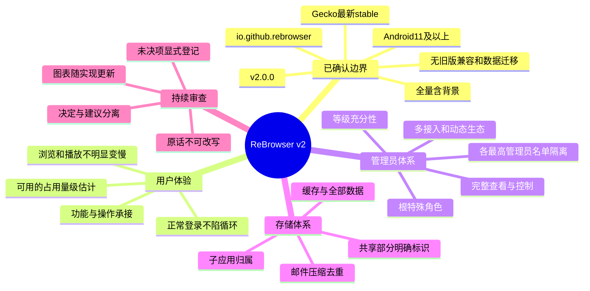

# ReBrowser v2 · 模块联动闭合 R52（当前：浏览器元数据持久化核心）

> **新增核心，非继续打磨既有UI：** 实质创建6个正式Java文件（5原PLAN＋1共享codec）、联动4个既有crypto/store/bootstrap文件，Java114→120、PLAN66→61。书签树、历史/保留/暂停写入、四搜索引擎和双内置子应用desired设置走固定私有AEAD记录与完整快照CAS；共享子应用服务区分desired状态与真实open/stop。实际120源码/613class/1034HOST，58纯切片552HOST＋实际SDKbootclasspath，新增49项（10codec＋19model＋20真实HOST文件/JCA/CAS）。不自动填默认、建密钥/目录、自动保存/恢复；Gecko历史/私密会话过滤生产者、Android真实IO/组件执行及管理员持久head适配仍未接通。详见[契约](records/native-browser-metadata-contract.json)／[执行](evidence/native-browser-metadata-host-execution.json)／[R52](reviews/R52-native-browser-metadata-core.json)。

> **历史R51，O90/O91：推进新核心文件，不陷入既有代码无限优化。** 本轮实质创建10个原PLAN正式Java文件、联动4个既有接口，Java104→114、PLAN76→66；不是空壳或DTO计数。新增禁用签名历史、低委托链、名单隔离/目标持钥、短时Actor/当前策略、请求任务预留桥、独立owner-grant及脱敏审计。实际985HOST（新增41项JCA/内核回归），57纯切片542HOST＋SDKbootclasspath；正式Root/设备表仍为空，NativeCurrent持久head/目标适配器、真正效果分发和Android OS验证尚未闭合，未激活外部入口。详见[契约](records/current-authority-kernel-contract.json)／[实际执行](evidence/current-authority-kernel-host-execution.json)／[R51审查](reviews/R51-new-core-authority-kernel.json)。

> **D03已主审（O88/O89）**：[L49–L73](records/low-cost-agent-assignments.json)的25个既有Java扩展，从owner指定 `dsh/result/d03/` 原样归档107文件后，主审独立复测并修正再整合；不算25新增文件/模块完成。25原始源哈希/6R49context核对，非目标源码/资产/context/build未混入。原分配及[分配时哈希检查](evidence/delegation-D03-assignment-checks.json)原样保留；当前无保留目标，详见[独立主审证据](evidence/D03-main-review-host-execution.json)，不沿用worker自述180通过。

> **D02主审（O80/O81）**：[42新任务](records/low-cost-agent-assignments.json)经独立哈希校验与原样归档后，R48并入36Java＋4未激活资产，2份未经批准的窗口/桌面CSS继续HOLD，不造空文件。初始[126目标风险](records/remaining-file-risk-assessment.json)及[分配时输入快照](evidence/delegation-D02-original-input-snapshots.json)保留；R48时77个PLAN，当前76个。worker原报告不是独立执行证据，未复制context/build脚本或修改原交付，详见[主审契约](records/D02-review-integration-contract.json)。

> **已按O26恢复并调整任务顺序。** 子应用占用查看/清理暂搁置；先技术验证，再构建应用本体全代码总树。O28要求保存后继续，不是暂停；O41允许已搞清实现方法的总树文件按文件推进，O42再次明确推送后不自行停工。[O25暂停快照](PAUSED_REVIEW.md)仅作历史记录。
>
> 当前：[应用本体目标代码总树](APPLICATION_CODE_TREE.md)／[全代码清单](records/application-code-files.json)／[技术验证状态](records/technology-validation.json)。已验证二进制、API编译、隔离R8 Release打包，以及O29授权手机上的[本地合成Native/扩展/MAIN世界/context子集](evidence/validation-android-local-synthetic.json)。**官网、真实播放、本人验证及Popup/恢复等仍未测**；不能宣称完整产品已实现或全部规划完成。

> 状态：**主线已按O45转为主程序与管理员系统代码实现，调查只按具体阻碍开展**。独立 `rebrowser` Android 工程、Application/原生主窗口/内部管理员控制台/来源闸门/Gecko owner和编译身份验签已开始真实编码；104个Java本体源码已准入，其中49个HOST切片、55个Android绑定WIP；另4个静态/合成DOM测试的运行资产仍未激活。按O67/O68/O69转为完整模块契约和联动闭合：入口与进程→浏览器核心→Gecko宿主→管理员协议→内建连接器→原生UI，依赖按需并行，边界/协议可按能力需求动态调整，不无限卡同一阻碍。R50独立主审修正D03的25既有代码扩展＋1共享View清理文件，保留82主线基线测试类，另28交付相关类123测试＋43项主审新增回归；实际AGP104源码/560class/944HOST，49纯切片501HOST＋实际SDKbootclasspath。修复真实帧/回调/原子批请求/伪发布/图像ABA/资源释放/词字符映射等缺陷；未执行Android View/媒体/Bitmap/Gecko/网站，Root仍未配置。历史R49跨11核心文件接通native epoch私有pin→一致保留目录捕获→4MiB严格二进制→既有AEAD/CAS→单次有界原生IO检查；原生壳只显式检查数量，不自动写/恢复。实际104源码/502class/778HOST；49纯切片427HOST＋实际SDKbootclasspath，新增50项严格区分合成来源/toy key/真实HOST文件与未执行的Android/Gecko。历史R48跨38个实质Java文件完成D02有限源整合与主审修正；实际AGP101源码/487class/728HOST，独立48纯切片398HOST＋实际SDKbootclasspath，20合成DOM断言＋5资产静态测试。未注册新Activity/激活新资产，也未执行真实Android/Gecko/CSP/网站。历史R47跨11个实质runtime文件连接accepted epoch→仅既有Android wrapping key→独立私有metadata AEAD→固定epoch目录的CAS/原子写/force/readback；不创建目录/密钥、不自动seed/恢复。实际AGP65源码/307class/577HOST，独立29纯切片293HOST+SDKbootclasspath；49项JCA/真实HOST文件流水线明确用PRIVATE合成Android来源和公开toy key，非Android Keystore/文件系统实测。D01原6交付67模型HOST及API通过，修复原生旋转常量、业务异常被当stale、实际view清理与取消/结束展示问题，仍不是完整UI/backend验收。

历史R46跨10个实质runtime文件接通accepted epoch→懒建临时浏览器域→私有context/Gecko privateMode→open前四delegate图；来源仍未配置，不自动激活UI/URL。Selection精确双revision拒绝工作区/标签ABA；session观察不冒充真实document。源发布另修复了未知Handler提交/确认前回调可复活的缺口：无肯定返回则拒绝。实际AGP56源码/264class/456HOST；独立纯切片26源码/260HOST+SDKbootclasspath。17模型＋13实际私有adapter/拒绝/body-close HOST用明确合成SDK DTO/回调及HOST流，不是原生Gecko回调或JNI尾部结束。持久化/restore、finiteGrant、真实document/Popup、完整入口/浏览器仍未完成。

历史R45跨12个实质runtime文件接入原生STABLE精确来源恢复回执：两次实际own signer/安装版本检查、compiledRoot、固定no-backup精确快照、30s一次性交接、单worker及Main发布闸门，epoch16贯通Gate/存储/分区/目标/runtime。当前Root仍未配置；23项回执流水线HOST测试使用明确私有合成OS来源，不是实际Android接受。实际离线AGP编译与413HOST通过，纯切片234项独立HOST及SDK bootclasspath、当前编译DDL HOST SQL39+235通过；manifest任务UP-TO-DATE核对。真实Android View/Window/Dialog/Gecko回调和完整网页UI仍未验证，Root/来源未配置保持锁定。R42独立Java检查保留为历史，不与本轮AGP混写；另有1033项独立JSON对照。正式来源/根未配置保持业务锁定，完整浏览器和命令准入仍未完成。正式密钥、设备登记与产品发行未开始；独立临时签名验证包已安装并运行，不是v2产品安装。按O37，旧主体ZIP与非主体回收站处置同属一个[旧结构审查整理任务](records/structure-retirement-policy.json)，与新版本验证/代码基础同轮并行；保存或一次整理不是暂停节点，价值未耗尽的仍保留。

| 视图 | 用途 | 权威输入 |
| --- | --- | --- |
| [主程序构建入口](../../rebrowser/README.md)／[实际主程序编译](evidence/production-main-app-compile.json) | 独立v2源码、原生主窗口/管理员控制台、49 HOST与55 Android绑定WIP＋4未激活静态资产，本轮实际AGP Java编译/1034项HOST，清单任务UP-TO-DATE核对 | 不混旧WebView应用，未打APK/装机；正式根/连续性缺失时不解锁 |
| [应用本体代码总树](APPLICATION_CODE_TREE.md) | 全部目标运行代码逐文件展开，区分PLAN与HOST，测试等辅助只概括引用 | O26／O27／O41，HOST不等于Android集成 |
| [逐文件实现准入](records/implementation-readiness.json)／[真实源码单元证据](evidence/production-unit-tests.json) | 已厘清职责/边界/依赖和测试后实现，不等所有领域完成 | O41／O42；主程序/编译身份验签/基础域，1034项HOST（552纯切片+10元数据+28合成认证控制流+12导航策略/SDK DTO+40任务线程/工作集/fence+10资源计数/策略+19窗口目标registry+42窗口界面/回调模型+27原生回执/提交模型+13临时宿主adapter/拒绝/close+32私有vault/IO边界+51D01Android绑定模型+46D02Android绑定模型+21保留目录IO/私有context边界+92D03交付相关/主审Android绑定模型+39浏览器元数据模型/真实HOST存储）；本轮AGP实际执行，不是Android UI运行 |
| [动作到本体文件路由](records/application-action-routing.json) | 178动作逐项指向目标领域代码；延期动作不伪造当前实现 | 不以UI Activity替代领域服务 |
| [主树文件权威清单](records/application-code-files.json) | 逐路径/职责/技术证据/辅助测试关联 | 不把测试/工具混入本体叶节点 |
| [旧结构审查整理：统一任务](records/structure-retirement-policy.json)／[回收站记录](records/noncode-retirement-review.json) | 主体ZIP／凭据保留／其他价值耗尽进Trash是同任务内分流，与新版本工作并行 | O37；不把一次整理当停止节点 |
| [ABI分包约束](records/abi-packaging-policy.json)／[当前单arm64验证](evidence/validation-arm64-apk-static-check.json) | 正式三ABI各自独立；手机临时测试仅arm64，校验13个库ELF与ZIP对齐 | O34／O35；不是正式三包已构建 |
| [临时存储预算](TEMPORARY_STORAGE_POLICY.md)／[历史回收](evidence/temporary-storage-recovery.json)／[O54本轮回收](evidence/temporary-storage-recovery-R35.json) | 仅自身过期实验包/可再生中间产物；峰值空间闸门，先低空间审查 | O33；不清设备/正式发布物/无关资料 |
| [旧结构任务中的主体审查](LEGACY_ARCHIVE_REVIEW.md)／[逐文件台账](records/legacy-archive-review.json) | 主体分支逐文件审查，合格后原结构进old_version.zip | 与上行同一个任务；临时代码不进ZIP |
| [手机合成运行证据](evidence/validation-android-local-synthetic.json) | 实际R8 Release Native/后台与内容端口/MAIN/context隔离/解绑重绑 | 仅本地合成，非官网或产品验收 |
| [技术验证状态](records/technology-validation.json) | Artifact/compile/Release包/Android运行分级；存储功能搁置 | 隔离验证，不触日常应用资料 |
| [完整性看板](views/10-completeness-board.md) | 逐领域缺口、完成标准和推进次序；不把图表数量当完成 | O17／O18、完整性账本 |
| [系统与体验](views/01-system-and-parity.md) | 组件、会话、能力边界 | R01–R10、功能矩阵 |
| [管理员权限](views/02-authority.md) | 根／最高管理员／名单关系、等级表达式、授权流程 | R10–R20、authority-model |
| [接入与生态](views/03-entrypoints-and-plugins.md) | 有线／无线／应用内／跨应用／动态介入 | R18–R20、接入矩阵 |
| [存储与清理](views/04-storage.md) | 归属、估计口径、删除状态机、API缺口 | R22–R25、E01–E05 |
| [邮件与登录](views/05-mail-and-auth.md) | AAD／MSA流程、压缩、去重、检索 | R21、R24、历史问题 |
| [签名与发行](views/06-trust-and-release.md) | 密钥分域、旧根保全、依赖／R8／加密性能 | R07–R09、R28–R30 |
| [高级静态准入](views/08-compiled-administrators.md) | 仅APK新增高级身份、严格禁用关系、不可禁用根 | R13、R31、R32、R35 |
| [可信来源与数据](views/09-root-continuity-and-data.md) | 四步确认、两次系统验证、A→异常B→正常C保持可信源、销毁后解锁 | R33、R34、R36–R38 |
| [实施与验收](views/07-roadmap-and-review.md) | 依赖图、审查闸门、验收矩阵 | P0–P7、测试／风险表 |
| [运行时与会话蓝图](views/11-gecko-runtime-sessions.md) | 单runtime候选、session/context所有权、Popup与崩溃契约 | A02／A05、E07–E10 |
| [浏览器与系统边界](views/12-browser-and-system-boundaries.md) | 正常/失败动作、下载流、权限、Popup、返回与系统交接 | A03／A04 |
| [控制协议契约](views/13-control-protocol-contract.md) | 持钥接入、包络、幂等、异步结果、跨应用与扩展边界 | A05／A10 |
| [邮件详细初稿](views/14-outlook-offline-design.md) | 登录、实体、压缩容器、事务、检索与离线阅读 | A06／A07 |
| [音乐原生分工初稿](views/15-music-engine-native-design.md) | 官网SDK/Gecko/Android媒体分工、状态与旧补丁取舍 | A08 |
| [资源与依赖初稿](views/16-resources-and-dependencies.md) | 线程/队列/预算及量测、工具链和依赖准入 | A13／A14 |
| [本轮集成契约核对](views/17-gecko-contract-review.md) | 已核实的回调/生命周期/媒体/存储候选及明确下一步，避免无边界阅读 | E14–E27、GC01–GC12 |
| [Gecko集成契约](records/gecko-contracts.json) | 12项来源已审/运行未验的实际约束与失败边界 | 固定stable源码 |
| [集成验证场景](matrices/gecko-contract-cases.csv) | 28项具体场景；全部planned-not-run | GC01–GC12 |
| [领域/连接器契约](views/18-domain-and-connector-contracts.md) | 模块输入输出、消息/流、真实任务与持久化轴、安全停止通道 | R7规范与时序例子 |
| [用户旅程/返回](views/19-user-journeys-and-back.md) | 首装/浏览/子应用/后台/设置和Back优先级 | 18条设计旅程 |
| [固定权限模块主机执行](evidence/permission-module-host-probe.json) | 原模块JS+合成Services/actors运行28项，确认永久/private-session、一次展示通知、上下文读取 | 不是Android或真实权限管理器通过 |
| [定位提供方源码主机研究](evidence/geolocation-source-host-probe.json) | 4个确切Java方法体＋合成位置管理器16断言；先选最精确缓存再选COARSE，global pause分支不等于单站停止 | 非JNI/Android/站点实际坐标；模糊定位仍阻断 |
| [浏览器后台所有权](records/browser-background-ownership.json) | 页面退出/OS交接/任务收敛与共享Runtime分开 | 不shutdown全部子应用，不以关页面冒充IO结束 |
| [Native网站权限契约](records/gecko-permission-design.json)／[来源与API编译](evidence/gecko-permission-api-and-lifetime.json) | clipboard原生回调与context字段已编译；永久engine allow和有限grant期限差异已确认 | 有限期限/粗细定位/停止使用仍待实测，不复制v1补丁 |
| [四平台动作具体契约](records/platform-action-contracts.json)／[主机DTO演算](review_platform_actions.py) | 参数/原生窗口代次/安装sourceRef/共享方法/完成与取消 | 四个动作子集，不是178动作DTO完成 |
| [控制请求签名字节契约](records/control-proof-format.json)／[跨实现主机检查](evidence/control-proof-cross-implementation.json) | 17字段帧、895项JCA/独立Python与OpenSSL、重放与新proof幂等规则 | 公开标量1合成材料，非Android授权实现 |
| [生产源码Android API编译](evidence/production-android-api-compile.json) | 25纯文件SDK37.2 bootclasspath证据保留；本轮改动2文件另实际bootclasspath编译；40源码独立JDK17+SDK类型编译，完整AGP仍R38 | 编译不等于Android运行，也不宣称API30已测 |
| [原文字节codec](records/mail-codec-implementation-contract.json) | RAW/zlib选择算实际帧开销；有界inflate/完整原文摘要、私有对象管线HOST通过 | 不是DB引用/游标提交或官网同步完成 |
| [流式对象加密边界](records/object-aead-implementation-contract.json)／[新旧互通](evidence/object-aead-production-interop.json) | 新对象一次性ID/canonical catalog头/32KiB认证帧，36双向与精确字节检查 | 不等于ZLIB原文验证、DB提交或Android加密通过 |
| [Native导航委托](../../app/src/main/java/io/github/rebrowser/engine/NavigationDelegate.java)／[范围](records/navigation-delegate-contract.json) | Browser域Source/session/partition闸门、显式web/blank加载判定、位置/历史/错误观测；12项HOST策略/SDK DTO测试 | 未执行真实回调；Popup及data/blob等方案未集成时拒绝，不冒充完整浏览器；Initializer现于open前收到精确SessionRef |
| [模块优先级/联动闭合](records/module-integration-plan.json)／[入口生命周期契约](records/entry-source-incarnation-batch-contract.json) | 先完整模块契约与可执行跨模块路径；当前12文件入口/资源生命周期，之后按优先级推进 | 接口/协议可动态协同调整，保留安全不变量与版本化历史；明确阻碍/退出条件，非无限研究 |
| [R47私有记录IO契约](records/native-private-record-store-contract.json)／[JCA+HOST流水线](evidence/native-private-record-store-host-execution.json)／[实际AGP](evidence/production-main-agp-R47-checks.json) | 65源码/307class/577HOST；49私有记录/包装/HOST filesystem；固定原生已有目录与key、128MiB/3201记录限额 | 无自动seed/清理/密钥生成，CAS/零IO不证明native全停/防回滚/销毁或实际Android持久性 |
| [D03主审契约](records/D03-review-integration-contract.json)／[独立执行证据](evidence/D03-main-review-host-execution.json)／[R50审查](reviews/R50-D03-reviewed-code-extension.json) | 25既有扩展＋共享清理，共26实质runtime文件；旧778＋交付相关123＋主审43＝944HOST；501纯切片实际Java8/SDKbootclasspath | 180自述/探针不是主审执行；各UI/模型/opaque receipt/offered/AEAD不变成授权、全模块或Android资格；当前无D03保留目标 |
| [保留目录核心契约](records/native-retained-browser-store-contract.json)／[50项新增HOST](evidence/native-retained-browser-store-host-execution.json)／[R49审查](reviews/R49-native-retained-browser-store-and-D03-assignment.json) | 11实质核心文件；source pin、coherent capture、strict codec、既有私有CAS/owned decode、单次弱窗口IO检查；当前AGP778 | 不把metadata ID/AEAD/校验和/CAS当最新/原生句柄/权限或恢复证明；真实checkpoint全量JSON物化阻碍明确，未执行Android Handler/View/FS/Keystore/Gecko |
| [D02主审契约](records/D02-review-integration-contract.json)／[独立HOST+资产证据](evidence/D02-main-review-host-execution.json)／[R48审查](reviews/R48-D02-reviewed-source-integration.json) | 40源候选有限并入、2样式HOLD；129模型/解析＋22新增主审回归，20合成DOM断言＋5静态资产测试；AGP728全通过 | 输入原样保存，纯DTO/显示/解析不是验证、权限或执行凭证；未接后端、未激活Activity/资产、未实测OS/Gecko/CSP/网站 |
| [D01六交付审查](evidence/D01-reviewed-worker-models-host-execution.json)／[R47审查](reviews/R47-native-private-record-and-D01-review.json) | 67真实模型HOST＋现有窗口模型新增5callback边界；旋转/异常/清理修正 | 未渲染真实Android View/Activity，未接完整历史/下载/书签/设置后台；R47时D02尚未收取，后续见R48 |
| [R46历史临时浏览器宿主契约](records/native-temporary-browser-host-contract.json)／[HOST](evidence/native-temporary-browser-host-execution.json)／[实际AGP](evidence/production-main-agp-R46-checks.json) | 源epoch→临时域→私有context→open前四delegate接线，10runtime；17model+13adapter/reject/close HOST | 拒绝未实现的持久化/grant/restore/Popup；外部body只close不读/重取/发布，延迟及native尾部未资格确认；无实际SDK会话 |
| [R45历史原生稳定来源回执](records/native-source-bootstrap-contract.json)／[HOST流水线](evidence/native-source-bootstrap-host-execution.json)／[AGP](evidence/production-main-agp-R45-checks.json) | 52源码/253class/413HOST；23回执/精确metadata IO/epoch分区/发布模型测试，原生平台事实明确合成 | 缺基准/非stable/轮换仅lineage继续锁定，未种植/修复/销毁；实际Android PM/FS/Handler和完整入口未验收 |
| [R44历史AGP检查](evidence/production-main-agp-R44-checks.json)／[当前入口批次](records/entry-source-incarnation-batch-contract.json) | 51源码/244class/386HOST；当前HOST SQL39+235，独立纯切片230 | NativeSourceView是原生已接受上下文的快照，不是认证回执；Root无配置仍锁定，未完成整模块实机验收 |
| [R43历史AGP检查](evidence/production-main-agp-R43-checks.json)／[十代码文件批次](records/native-browser-window-batch-contract.json)／[只读提交前检查](check_commit_batch.py) | 51源码/238class/367HOST；编译/测试任务实际执行，清单任务UP-TO-DATE核对 | 10是本批runtime源文件最小工作量，不是上限或完整职责验收；无JNI/dex/R8/APK/设备运行 |
| [R42历史低内存独立检查](evidence/production-main-standalone-jvm-checks.json)／[最近完整AGP](evidence/production-main-agp-R38-checkpoint.json) | 本轮compact192MiB heap/96MiB meta/48MiB code、顺序JVM、内存≥2048MiB；原Android构建≥3GiB闸门不变 | JDK java.base+SDK类型类路径不是Android bootclasspath；六个改动原生文件另单独实际bootclasspath检查，非APK/运行 |
| [Gecko进度/快照回调](../../app/src/main/java/io/github/rebrowser/engine/ProgressDelegate.java) | 实际SDK加载/安全观测、Source/session/partition检查和单占位敏感SessionState copy转交 | 仅API编译，没有新增回调/Gecko测试；PageStop非任务完成、失效不释放旧writer、observer未知不重试、无明文快照日志 |
| [确认状态/原话](../../app/src/main/java/io/github/rebrowser/continuity/ContinuityState.java)／[系统机主验证源码](../../app/src/main/java/io/github/rebrowser/continuity/OwnerAuthentication.java) | O16精确4文案/Force2和3各新Android验证、positiveOSnoLock、绑定源/epoch/步骤的私有票据；实际API编译 | 文案/绑定及28项合成平台控制器/私有票据/桥接方法已测；没有真实AndroidPlatform/OS验证。LastGood存储和下行四步reducer已有切片；整体来源协调/销毁/解锁未完成，权限声明不等于实际验证 |
| [四步来源协调](../../app/src/main/java/io/github/rebrowser/continuity/ContinuityCoordinator.java)／[边界](records/continuity-coordinator-contract.json) | 原生步骤/代次、两独立私有验证attempt、未知工作保留、30秒一次性最终consent；24项纯reducer HOST测试 | reducer信号为合成Native输入；OwnerAuthentication另28项实际方法HOST合成平台执行，非OS认证/擦除/epoch提交/解锁 |
| [认证控制流HOST边界](evidence/owner-auth-synthetic-platform-host.json)／[契约](records/owner-auth-host-control-contract.json) | 实际OwnerAuthentication控制器/私有Ticket消费/桥接，反射私有构造注入合成平台；28项HOST | 生产公开构造仍仅Activity；未执行AndroidPlatform/真实锁屏/生物认证/实际签名读取，不能当系统身份凭据 |
| [最后正常来源存储](../../app/src/main/java/io/github/rebrowser/continuity/LastGoodSourceStore.java)／[范围契约](records/last-good-source-store-contract.json) | 保留A的signer/Root/epoch跨pending B，独立阶段/严格216B帧/文件锁/CAS/force/原子替换/读回；17项真实HOST临时文件系统测试 | 非Android文件系统/掉电/实际C包救援；checksum和进度记录不是授权、已验证销毁或解锁；缺失marker不是首次安装证据 |
| [原生Back](../../app/src/main/java/io/github/rebrowser/browser/BackCoordinator.java)／[自身签名身份](../../app/src/main/java/io/github/rebrowser/continuity/SigningIdentity.java)／[编译Root](../../app/src/main/java/io/github/rebrowser/continuity/CompiledSourceIdentity.java) | 只消费一层/原执行者待办/代次失效不假结束；实际自身包+UID签名API及编译Root只读元数据 | HOST层回调/TOY元数据不是AndroidBack/签名实测；不写lastGood/不解锁，不把合法signer轮换当不同Root可信 |
| [实际导航输入](../../app/src/main/java/io/github/rebrowser/browser/SearchEngines.java)／[Android外链边界](../../app/src/main/java/io/github/rebrowser/browser/ExternalNavigation.java) | 4固定搜索入口/结构化HTTP目标/不透传Intent extras/grants，选中Tab/revision后SDKloadUri；11新HOST测试 | 不把URL结构当实际origin/权限；Native外链receiver未激活、主窗口仍锁定，不代表已运行浏览 |
| [浏览器领域](../../app/src/main/java/io/github/rebrowser/browser/BrowserCoordinator.java)／[工作区](../../app/src/main/java/io/github/rebrowser/browser/WorkspaceCatalog.java)／[标签](../../app/src/main/java/io/github/rebrowser/browser/TabCatalog.java) | 总树7个新文件含不可变模型/分区/GeckoSession/View所有权；20项新HOST测试及Native API编译 | 主窗口网页接入/持久BrowserStore/正确恢复/A04尚缺，不是完整可用浏览器；retire/close不等于数据抹除或任务结束 |
| [实际动作参数](../../app/src/main/java/io/github/rebrowser/control/ActionSchemas.java) | 四项已知原生窗口schema严格类型/字段/整数/引用/安装源配对，接入内部控制台；保留原始signedargs | 只含4项，其他174项拒绝；不是有效权限/真实target/revision/OS动作执行 |
| [真实任务日志](../../app/src/main/java/io/github/rebrowser/core/TaskJournal.java)／[任务分轴快照](../../app/src/main/java/io/github/rebrowser/core/TaskSnapshot.java) | 真实work/dispatch-intent/outcome/end分轴，request/task单次提交，进程丢失未知不重放；235HOST SQL含196转换对/2writer/回滚重开 | 未执行Android DAO/实际效果；原执行者settlement与新代数据发布分开，快照不释放槽位 |
| [原生请求幂等账本](../../app/src/main/java/io/github/rebrowser/control/IdempotencyStore.java) | 真实Android SQLite代码、不可变request/job/内容冲突、source/target/epoch检查；类DDL在HOST SQLite39检查和磁盘重开 | Android SQLite事务及完整TaskJournal/效果调度未测，未执行命令 |
| [真实挑战存储](../../app/src/main/java/io/github/rebrowser/control/ControlChallengeStore.java) | 30秒、精确签名字节/目标与策略绑定、事务内同步CommitFence最终授权/期限重查、进程内一次reservation和1MiB保留界限 | 不是SQLite跨policy原子性或已执行命令，未知提交结果不重放 |
| [请求取消与真实工作结束](records/core-cancellation-contract.json) | 独立Requester/Reporter、原子不可变状态；真实HOST并发和Future已done而worker仍运行 | 不释放槽、不证明远端效果或持久化、不是Gecko停止 |
| [严格未验证包络解码](records/control-decoder-contract.json)／[独立JSON对照](evidence/control-json-differential.json) | 不可变类型树、重复/Unicode/类型与预算、代理摘要；Python/Java1033项一致 | UnverifiedProof不是身份；逐动作schema/验签/准入仍未完成 |
| [公钥/编码实现契约](records/crypto-encoding-contract.json) | P256 canonical SPKI＋曲线/点、DER正标量、s/n-s等价、规范有界Base64url/SHA | 格式合法不等于验签或取得权限，未生成真实密钥 |
| [提前arm64过滤证据](evidence/arm64-early-native-filter.json) | 仅merge/strip两阶段，各13库原字节匹配官方AAR | 阶段任务通过，不等于新APK或运行通过 |
| [领域接口](records/domain-interfaces.json) | 11个逻辑组件50个方法，不要求拆成Gradle模块；平台流程显式归属 | 明确所有权/线程/能力覆盖 |
| [连接器协议](records/connector-protocol.json) | 消息/流信用/租约/通道预算的权威定义 | 不等于管理员证明协议 |
| [动作语义与类型](records/action-semantics.json)／[参数DTO](records/domain-payloads.json) | 首批13动作的字段/完成/重试；其余动作仍待补 | 不是全功能注册表完成 |
| [任务时序例子](records/runtime-traces.json)／[离线演算器](review_runtime_design.py) | 超时不释放、旧结果结算、独立停止、静默及持久化 | 纯设计模型，非Gecko实测 |
| [邮件存储与合成基线](views/20-mail-storage-and-codec-evidence.md) | 小对象内联/大对象文件、codec/去重/事务；已做合成主机实验，不是Android性能 | A07、R8设计与原始结果 |
| [邮件存储设计](records/mail-storage-design.json)／[主机实测结果](evidence/mail-codec-host-baseline.json) | 同账户对象/表/索引/回收；Deflate/GZIP与可选既有主机Zstd对照 | 未加入产品依赖/未用真实邮箱 |
| [领域设计工作包](matrices/design-backlog.csv) | 16个工作包及真实欠缺项，不是已完成任务清单 | 完整性账本 |
| [完整性账本](records/completeness.json) | 每领域状态、交付标准、证据和责任 | 整体未完成／未就绪 |
| [工程选择记录](records/engineering-choices.json) | 助手负责论证的候选与撤回条件，不冒充机主指令 | O18 |
| [需求](records/requirements.json) | 每条规则及原话来源 | 机主原话 |
| [决定](records/decisions.json) | confirmed / verified-upstream / design-proposal | 不混用状态 |
| [未决项](records/questions.json) | 需机主确认与工程验证的问题 | 不用猜测填空 |
| [原话清单](owner-verbatim/manifest.json) | 逐条原文与UTF-8摘要 | 原文独立、只追加 |
| [旧版公钥保全](evidence/legacy-public-trust.json) | 公钥、用途、摘要；私钥保管未核实 | v1.0.5源定义 |
| [上游API证据](evidence/upstream.json) | Gecko158公开API事实，不是能力臆测 | Mozilla原始源码 |
| [AAR元数据证据](evidence/aar-metadata.json) | minSdk26、compileSdk37 minor2、三个ABI及内部子进程 | 有界范围读取，不是完整构建 |
| [兼容矩阵](matrices/compatibility.csv) | Android11基线/真实ABI/系统WebView无关/待测项 | 不将构建SDK当用户系统门槛 |
| [审查记录](records/review-log.json) | 发现、决定、重开原因 | 每次修正留痕 |
| [规则演算](matrices/authority-cases.csv) | 具体根／最高／中级／授权／名单案例 | 同级可控、来源中立已确认；数字仍待审查 |
| [高级准入／禁用演算](matrices/principal-policy-cases.csv) | 编译新增、低级委托、更高禁更低、Root不可禁 | 不执行实际管理操作 |
| [根连续性案例](matrices/root-continuity-cases.csv) | 不同根、机主许可、正确包抢救、三确认、删除范围 | 全部仅计划，未删除任何资料 |
| [旧约束的替代关系](records/supersessions.json) | 防止把已解除的旧兼容约束重新带回 | 后说且明确的机主决定优先 |
| [规划自检](review_plan.py) | 标准库检查原话摘要、引用、覆盖与规则案例 | 不是产品功能测试 |
| [四步确认演算](matrices/confirmation-cases.csv) | 点击、逐次系统验证、无锁例外、销毁核对前保持锁定 | 不调用设备身份验证、不执行删除 |
| [跨异常包来源演算](matrices/source-continuity-cases.csv) | lastKnownGood不被lastSeen覆盖；正常后续包认回原数据 | 仅符号演算，真实APK救援仍待样机验证 |
| [任务调度/真实工作集](records/task-coordinator-contract.json)／[HOST线程证据](evidence/task-coordinator-host-execution.json) | AUTH/EFFECT/READ独立有界通道、保留SAFETY、Journal真实适配器；实际结束才释放内存工作槽，来源锁定仍可结算旧内存工作 | 合成journal HOST执行，非Android SQLite/完整管理员准入或全域销毁静默证明 |
| [资源预算](records/resource-budgets-contract.json)／[计数证据](evidence/resource-budgets-host-execution.json) | 原生Android内存等级工厂、字节/对象双限和一次释放；仅可重建内存trim建议 | 实际OS工厂未执行，无文件/子应用数据清理或Gecko全局内存保证 |
| [事务内当前状态闸门](records/task-journal-native-fence-contract.json)／[当前编译SQL等价](evidence/task-journal-current-schema-equivalence.json) | 实际TaskJournal在获锁后和提交前强制复核；私有原操作/线程fence拒绝过期/逃逸/递归/跳过 | 当前DDL与历史235 SQL输入相同，不冒充本轮重跑或真实Android事务/完整权限序列化 |
| [原生目标句柄WINDOW切片](records/target-references-contract.json)／[HOST证据](evidence/window-target-references-host-execution.json) | 精确原生Activity/Application/Window、epoch/revision绑定；弱UI引用与退役/tombstones，派发前重查 | 实际Android窗口/ActorContext/派发器及其他目标种类未接通；ref/lease不是权限 |
| [原生窗口组件与模型](evidence/native-window-models-host-execution.json) | 工具栏、双层标签面板、多选、单调渐变进度、Dialog所有权、own-window样式/insets/metrics；37HOST模型测试 | 真正Android绘制/回调、核验epoch/域工厂、完整UI/有限权限/恢复未接通 |
| [R46入口/浏览器/宿主联动审查](reviews/R46-native-temporary-browser-host-review.json) | 精确Selection、native闭合/观察图、源发布确认前拒绝；不是UI叶节点累计 | 实际Android源/SDK会话/私有数据持久化与文档/授权生命周期仍是具名退出门槛 |
| [R45历史原生来源回执审查](reviews/R45-native-stable-source-bootstrap-review.json) | stable精确恢复提供器已编码，跨12runtime消费者；来源epoch强绑定 | first-fresh精确清单/seed、rotate/rescue、销毁提交及实际Android资格仍待；不是metadata布尔解锁 |
| [R44历史模块闭合切片审查](reviews/R44-entry-module-source-lifetime-review.json) | 实际process路由/唯一Startup/原生incarnation和permit代次/跨模块sticky资源pin；12个runtime文件 | 真实Android进程/source接受/SQLite DAO/Gecko创建未执行；入口完整激活仍依赖原生continuity接受提供器 |
| [R43历史自检结果](reviews/R43-ten-native-code-file-window-batch-review.json) | 本批10个runtime代码文件，实际AGP和367HOST | 未把工作量/编译当产品完成 |
| [R42历史自检结果](reviews/R42-native-window-target-reference-review.json) | 43源码/330HOST，6改动原生文件SDK bootclasspath编译 | 非产品/Android UI完成 |
| [R41历史自检结果](reviews/R41-native-task-transaction-fence-review.json) | 42源码/312HOST，5改动原生文件SDK bootclasspath编译 | 非完整产品/Android运行 |
| [R40历史自检结果](reviews/R40-native-task-resource-source-review.json) | 42源码/304HOST、分级编译与负面运行声明 | 非产品完成或Android运行 |
| [R39历史自检结果](reviews/R39-browser-navigation-source-bounded-validation-review.json) | 结构/演算/主树路由/旧代码台账与分级运行证据 | 不将合成运行当完整官网/产品通过 |

## 使用约定

| 原则 | 规则 |
| --- | --- |
| 单一事实来源 | 原话→需求／决定／能力注册表→图表；不在多份图里独立重定义权限数字 |
| 语义分离 | 机主确认 ≠ 设计建议 ≠ 上游已验证 ≠ 实现完成 ≠ 真机通过 |
| 修改路径 | 需求变化先追加原话；API不符登记证据；重开受影响决定、图、验收项 |
| 代码准入 | O41后按文件完成调研/安全边界和测试设计再实现；全局未决不阻塞无依赖的已就绪节点，但不挂未完成授权入口；每个用户能力仍有统一控制与测试 |
| 隐私 | 设备序列号、账号、私钥、原始截图留仓库外；这里仅用设备别名及公开信任材料 |
| 既有发布 | v1.0.5及旧根维护资料保留；机主README不改；无自动迁移／卸载／清数据 |
