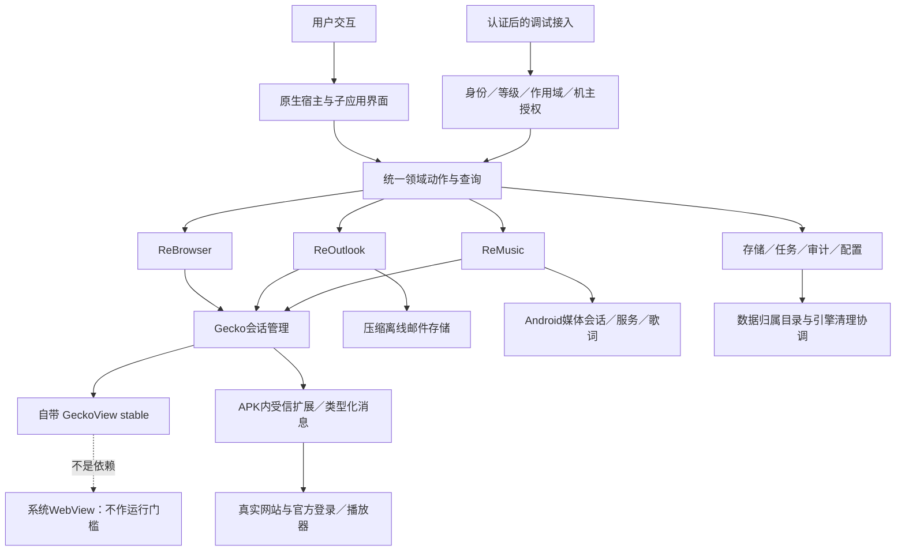
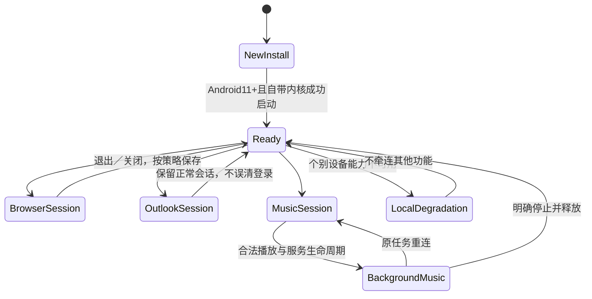

# 系统与体验 · R01–R10 · 设计草案

| 设计对象 | 新实现原则 | 不能偷换的验收 |
| --- | --- | --- |
| 会话／隔离 | 用Gecko原生runtime/session/context建模；实际隔离拓扑待P1验证 | 不复用任意站点／另一子应用的登录环境 |
| 功能承接 | 对照[功能矩阵](../matrices/feature-parity.csv)，不复制旧类结构 | 双层标签、书签／历史、下载、返回／Popup、权限、离线邮件、音乐系统控制等逐项确认 |
| 浏览器与网站能力 | Native delegates优先，扩展只做必要受控集成 | 不以任意JS桥或裸远程调试端口替代架构 |
| 音乐 | 官方认证→同一音乐隔离上下文→真正播放器；重新评估旧引擎补丁 | 手机UA登录；桌面扫码仅机主主动且平板＋全窗口＋横屏；未知认证不放行业务 |
| Android11兼容 | 不查系统WebView包／版本；验证ABI、GPU、内存、权限、编解码器 | 不能宣传已覆盖全部Android11设备；缺单项能力尽量局部降级 |
| 新包 | io.github.rebrowser；v2.0.0；正式新签名；含背景全量 | 无旧数据迁移；不自动删除旧应用／旧数据 |
| 体积 | 自带内核不可避免变大；先测再解释 | 不承诺保持旧版219KB／1MB包体 |

**未决连接：** runtime/context与物理存储、后台音乐、清理回执的选择共同影响架构，见Q09／Q10；不能先画成“每个context独立目录”再把假设当事实。
