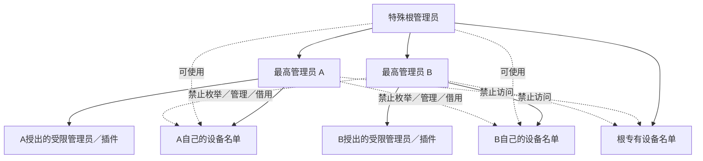
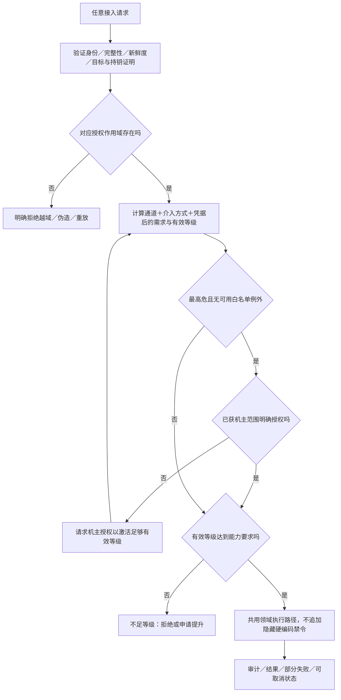

# 管理员权限 · R10–R20 · 设计草案



| 规则 | 状态 | 原话依据 |
| --- | --- | --- |
| 根可管理其他最高管理员、使用全部最高管理员及根自身名单 | 已确认 | O09 |
| 普通最高管理员名单彼此隔离，不能用根专有名单 | 已确认 | O09 |
| 白名单外最高危，根与其他最高管理员均需机主授权 | 已确认 | O07／O09 |
| 等级达到或超过对应能力需求时必须能控；管理权限随等级扩张 | 已确认，采用≥ | O09／O13 |
| 同等级也允许 | Q01已关闭 | O13明确确认 |
| 名单隔离保护设备隐私与枚举／管理／借用权限；公钥用于匹配管理策略 | Q02已关闭 | O13：不把公钥本身与真实设备资料混为一谈 |

## 等级表达式：提案，不是已确认数字

```text
RootAllowedDevices = Own(root) ∪ ⋃ Own(highest_i)
HighestAllowedDevices(a) = Own(a)

Required(c, transport, intervention)
  = max(base_threshold(c), transport_risk_floor, intervention_risk_floor)

Effective(a, session, credential)
  = min(identity_ceiling, session_grant_ceiling, credential_assurance_ceiling)

AuthorizedScope(a,c) ∧ FreshAuthenticatedGrant(a)
∧ Effective(a,...) >= Required(c,...)
  ⇒ ExecuteThroughSameDomainService(c)

在同一作用域／会话条件下：L2 > L1 ⇒ Capabilities(L1) ⊆ Capabilities(L2)
管理权限也须满足对应单调扩张，不允许高等级反而失去低等级已有能力。
```



| 一致性问题 | 处理 |
| --- | --- |
| “高等级必可”与名单隔离 | 名单管理是作用域限定的对应能力；普通最高管理员没有他人名单作用域。不能用数字抹掉机主明确要求的隔离。Q06须审查这一解释。 |
| “等级充分必可”与机主授权 | 授权先激活足够有效等级；缺授权时上限必须严格低于要求，不能等于要求而被≥放行。不得宣称等级已足够后再加隐藏禁令。 |
| 白名单免确认 | 不免身份认证／重放防护／目标验证；不是ADB连上就等于根。 |
| 外部约束 | 管理员可发起用户能发起的流程；Android强制权限、网站验证码／登录／权益不是本应用可以绕过的授权。 |
| 覆盖完整性 | 新增用户动作必须登记相应调试能力、阈值、目标、可观察结果与测试；矩阵遗漏视为设计缺陷。 |

[权威表达式](../records/authority-model.json) · [能力注册草案](../matrices/capabilities.csv) · [授权案例](../matrices/acceptance.csv)
