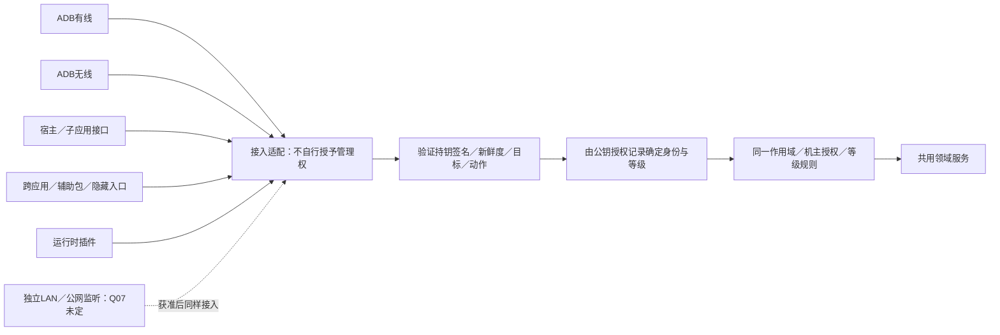
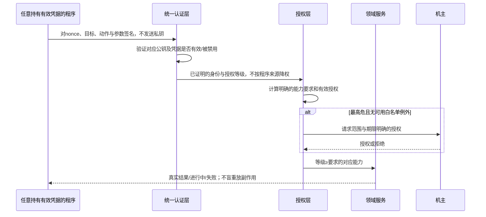
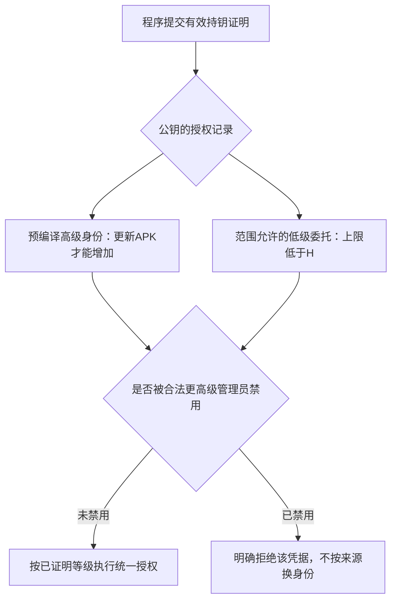

# 接入与动态生态 · R18–R20／R31／R35 · R3

| 已确认规则 | 含义 |
| --- | --- |
| O14：不问来源，只问证明有权 | 同一中级私钥可由多个程序共用；不额外要求它们都是指定签名辅助包 |
| 权限等级识别 | 公钥→已授予身份/等级；不是请求自报等级，也不是把私钥当明文口令发送 |
| 来源中立 | caller UID/包名可作诊断，但不得变成对有效权限证明的额外来源否决 |
| 通道风险 | O09已要求接入/介入影响等级；必须是明确的能力需求/授权规则，不暗中重定义持钥身份 |
| 可复制性 | 谁复制并持有该私钥，就能作为同一身份使用；这是已选择的凭据模型，不再据此强制绑定辅助包或单独降级 |
| 接入安全 | 来源中立不取消签名验证、nonce、防重放、目标及参数绑定、撤销、加密传输与审计 |
| 目标设备 | 不限制调用者程序来源，不等于免除目标设备持钥证明；编译的设备公钥仍用于正确判定免确认名单 |
| 高级身份 | 只能来自APK预编译信任表；Root也不能运行时新增高级身份 |
| 低级动态生态 | 低于高级边界H的委托/插件仍可设计；不能经委托/导入/自报阈值绕过高级静态准入 |

隐藏入口不是授权；无线ADB不是自行开放公网端口的许可；不得把跨应用权限重新缩回仅少数固定外部命令。
