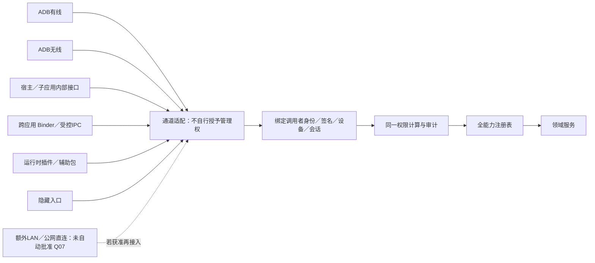
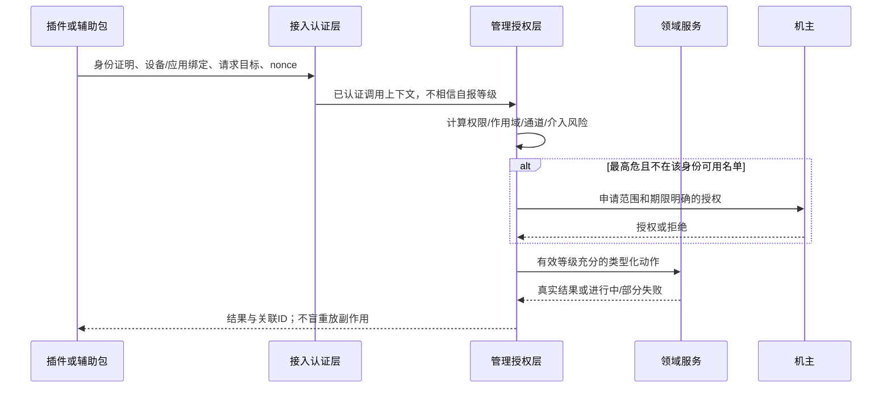
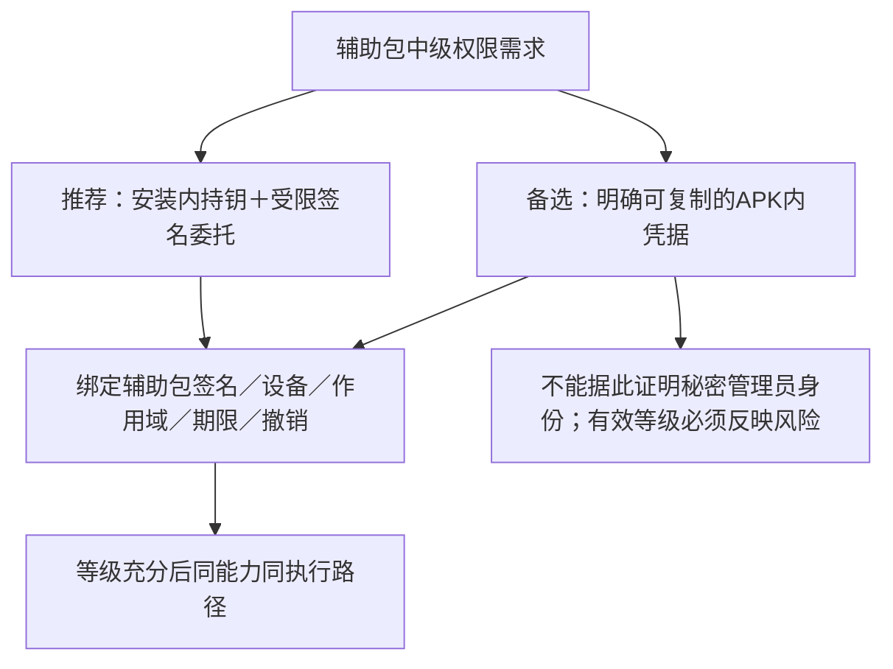

# 接入与动态生态 · R18–R20 · 设计草案

| 入口 | 不等于 | 需纳入策略的事实 |
| --- | --- | --- |
| USB／无线ADB | 不自动等于根管理员 | 管理签名、设备绑定、无线配对/链路、风险与新鲜度 |
| 应用内接口 | 不因“内部”而自动免认证 | UI机主动作身份与管理员身份分开；目标范围明确 |
| 跨应用IPC | 不信任自报包名／UID参数 | 系统提供caller UID；包签名／委托／安装密钥绑定 |
| 动态插件 | 不可自行声明高等级 | 委托签发者、上限、范围、期限、撤销、代码来源 |
| 隐藏入口 | 隐藏不构成安全边界 | 必须进入同一个授权策略 |
| APK内嵌私钥 | 不保证秘密或不可复制 | 可提取；需Q03决定可复制凭据模式与签名/设备绑定 |

## 辅助包委托的两个候选

**Q03未决：** 不是直接否定插件生态，而是不能以“混淆或加密后私钥不会泄漏”作为信任假设。根私钥绝不应作为插件发行材料。具体等级数字尚未批准。
