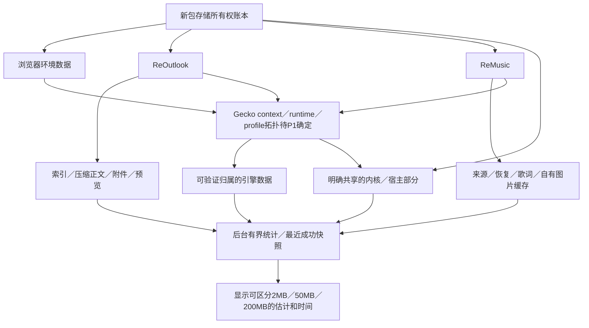
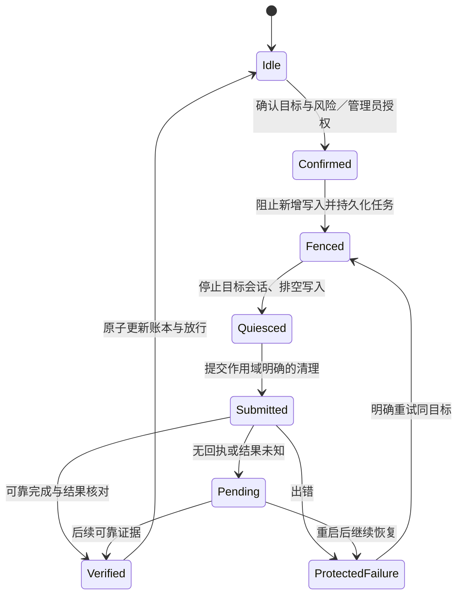

# 存储与清理 · R22–R25 · 设计草案



```text
ChildEstimate = OwnedPersistent + AttributableRebuildable + VerifiedEngineEstimate
KnownSubtotal ≠ CompleteTotal
CacheComponent ⊆ 某些站点的storage usage；不是另加一次
SharedEngineBytes：单列；不把同一份重复算给每个子应用
NoLivePage：仍可显示明确标注时间/范围的最近统计，不伪造实时读数
Unknown／Estimate／ExactOwnedFiles：分开表示
```

| 区域 | 查看口径 | 清缓存 | 清全部数据 |
| --- | --- | --- | --- |
| 应用自有可重建内容 | 自有目录／账本直接统计 | 可清；未保存内容与离线唯一副本不归此类 | 可清 |
| 离线邮件正文／附件 | 压缩后实际文件/BLOB归属，含索引开销 | 默认不能当安全可重建缓存丢弃唯一副本 | 明确不可撤销后按作用域清 |
| Gecko可归属数据 | 经P1验证的上下文口径／估计 | API若无法安全按子应用清理，不能回退全局 | 作用域与完成确认都要验证 |
| 共享内核缓存 | 单列共享，说明是否含在估计内 | 明确共享清理操作，不冒充单子应用 | 不因清一个子应用而串删 |
| 当前网页quota | 仅补充来源，不作为完整总容量 | 不等于HTTP缓存释放量 | 不作为删除完成判据 |

## 已核实的Gecko158接口差异

| 证据 | 接口 | 不能假设 |
| --- | --- | --- |
| E01 | clearData(flags) → GeckoResult | 是全部host，不是指定context |
| E02 | clearDataFromHost(host,flags) → GeckoResult | host不等于子应用；不含其第三方存储 |
| E03 | clearDataFromBaseDomain(baseDomain,flags) → GeckoResult | 基域与第三方关联不等于某子应用独占 |
| E04 | clearDataForSessionContext(contextId) → **void** | **没有完成回执**；不能说方法返回即清理完毕 |
| E05 | SessionSettings.contextId | 不证明物理缓存目录独立或存在完整容量查询 |



**设计闸门Q09／Q10：** 先验证清理隔离及完成模型，再选存储拓扑；不为获得容量数字而启动网站、借用别的上下文或清全局数据。统计可粗略，删除范围不能粗略。
