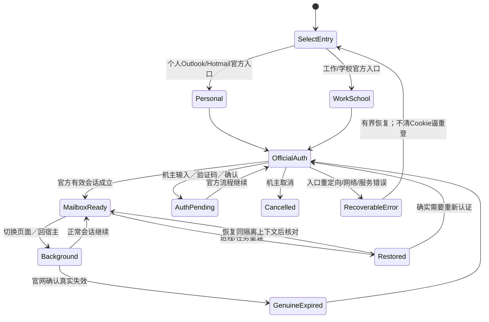
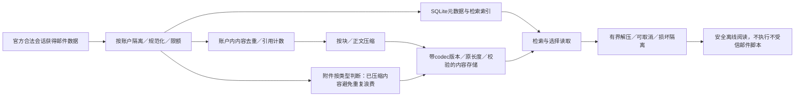

# ReOutlook与离线邮件 · R21／R24／R25 · 设计草案

| 历史事实 | 新验收要求 | 不得偷换 |
| --- | --- | --- |
| 平板截图：AadOrMsaRedirRequired／Preboot／ClientError | AAD与MSA两种官方入口；正常登录、取消、真实失效、重进/重建均验证 | 不能据错误页直接断言Cookie已清除；换Gecko不会自动修正业务入口 |
| 旧版固定office入口，多处返回复用 | 统一入口状态与会话恢复策略，不在按钮/返回路径散落常量 | 不盲目把工作/学校用户改送个人入口 |
| 旧统计依赖仍存在的网页 | 使用所有权统计与可保存的统计快照 | 不只靠当前页面quota，不冒充完整容量 |

| 设计项 | 初始候选 | 必须测量 |
| --- | --- | --- |
| 编解码 | 平台高等级Deflate/GZIP为无新增依赖基线；Zstd等仅有显著收益才准入 | 实际落盘比例、压缩/读取耗时、峰值内存、库体积/ABI |
| 大量邮件 | 正文去重、分块/逐记录、增量事务；避免重压整个数据库 | 2MB／50MB／200MB及大量小邮件、重复长会话 |
| 检索 | 元数据索引与正文检索成本独立设计 | 不能静默删除旧有搜索能力；索引占用也计入 |
| 性能 | 后台有界任务，不挡浏览/播放/阅读；必要时限制并发 | 低端Android11、前台交互、取消及进程中断 |
| 数据安全 | 保存codec/校验/长度/版本；有界解压；引用计数事务一致 | 压缩失败、断电/杀进程、损坏块、解压炸弹、孤儿回收 |
| 隔离 | 默认账户内去重，不跨账户泄漏或错归属 | 不把另一个账号的唯一离线副本当缓存删除 |

**Q11：** 压缩算法和等级尚未确定；没有引入第三方压缩库，没有读取真实邮箱作基准。旧数据库不迁移，但其用户功能仍需承接。
