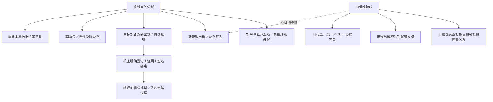
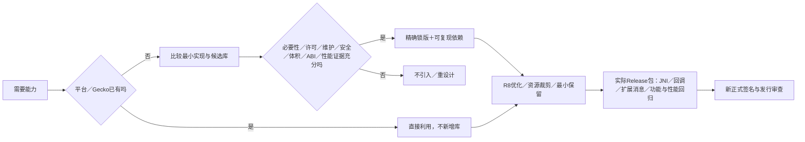

# 信任、依赖与发行 · R07–R09／R28–R30 · 设计草案

| 密钥 | 可公开部分 | 私钥状态／义务 |
| --- | --- | --- |
| 旧reoutlook-root-v1／rebrowser-root-v1 | [公钥与摘要归档](../evidence/legacy-public-trust.json) | 保管尚未核实；不能因v2不兼容就丢弃 |
| 旧导出RSA | 同上；用途与签名根不同 | 老导出资料恢复可能仍需要；不能假称已备份 |
| 新APK签名 | 证书及指纹 | 未生成；独立安全保管与恢复演练 |
| 新管理员根／委托 | 验证公钥、角色、撤销链 | 未定算法/轮换/恢复；Q05／Q08 |
| 设备白名单 | 安装公钥可编译，但不是秘密 | 尚未生成；当前设备信息不等于登记完成 |
| 辅助包凭据 | 公共身份及受限委托 | APK内嵌私钥可提取；Q03不能靠混淆假装解决 |

| 加固 | 允许方向 | 不采用的捷径 |
| --- | --- | --- |
| 混淆／裁剪 | R8优化、压缩、资源收缩、最小可解释keep规则 | 全包keep、为通过构建盲删Gecko传递依赖 |
| 选择性加密 | 有威胁收益的重要数据/配置；密钥与密文分离、版本化 | 整个Gecko/所有DEX二次加密导致启动明显变慢；自定义壳替代认证 |
| 原生引擎 | 验证ABI与发布尺寸；保留许可与安全更新路径 | 声称R8能裁掉Gecko的C++引擎；随意删.so或编解码器 |
| 兼容性 | Android11+、ABI/GPU/内存/权限场景矩阵 | WebView缺失/老版本导致整个应用拒绝运行 |
| 包型 | 默认唯一含背景全量；明确要求才定制 | 自动继续生成极简/无背景分支 |
| 旧版 | 新包全新开始；旧版保留 | 自动读迁Cookie/邮件、卸载旧包、改旧签名/标签/资产 |

**待验证：** Gecko stable158的POM包含AndroidX、Kotlin、Media3、FIDO等上游依赖；这不是额外引库的空白授权，也不能未经验证排除后宣称可用。AAR只查询过大小，尚未下载/构建。
