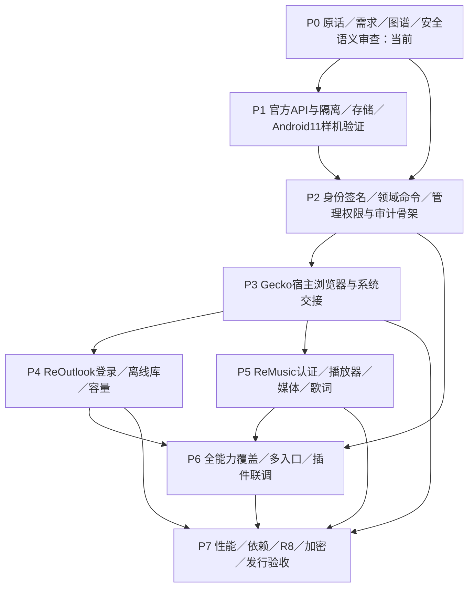
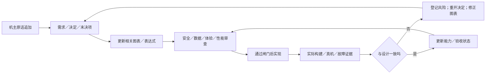

# 实施与审查 · R26／R27 · R1规划草案

| 闸门 | 当前状态 | 不能用什么替代 |
| --- | --- | --- |
| 机主原话与确认决定 | 已转录、待自检 | 用助手概括替换原话 |
| 权限充分性／隔离／机主授权一致 | Q01–Q06未决 | “后面再补安全”或隐藏例外 |
| 编译名单/密钥保管 | 公钥归档；新密钥/设备登记未开始 | 用序列号或APK签名当设备公钥 |
| Gecko上下文/清理/容量 | 仅API事实E01–E06 | 把void派发当完成，把host当子应用 |
| 体验承接 | 已列矩阵；尚未实现/验收 | “换内核了所以可以缺功能” |
| 压缩与依赖 | 候选及基线；未加库 | 只看压缩率，不测读取/检索/内存 |
| Release | 不在本阶段执行 | 仅Debug测试或仅R8报告 |

| 审查输入 | 可检查的问题 |
| --- | --- |
| [能力表](../matrices/capabilities.csv) | 所有用户动作有没有对应调试入口？是否都进入统一授权？ |
| [接入表](../matrices/transports.csv) | 有线/无线/应用内/跨应用是否有等级依据，是否存在旁路？ |
| [体验表](../matrices/feature-parity.csv) | 新实现是否漏掉旧的用户能力？有无主动引入不必要体验变化？ |
| [验收表](../matrices/acceptance.csv) | 有无正反用例、故障恢复、等级性质、真实设备及Release测试？ |
| [风险表](../matrices/risks.csv) | 未解决的设计事实有没有被悄悄标成完成？ |
| [未决项](../records/questions.json) | 哪些必须机主决定，哪些应由工程样机给证据？ |

## 后续每个实现提交的检查单

- [ ] 关联R／C／T编号；先更新受影响决定、图与风险。
- [ ] 每个新用户动作有相应管理员能力，级别足够时同路径执行。
- [ ] 改权限时重跑单调性、名单隔离、接入方式、机主授权与撤销测试。
- [ ] 改存储时更新归属、估算口径、清理状态机和故障恢复。
- [ ] 引库前准入，发行前验证R8/JNI/扩展协议保留与实际性能。
- [ ] “计划／实现／离线通过／真机通过／未测”分别标注，不互相替代。
