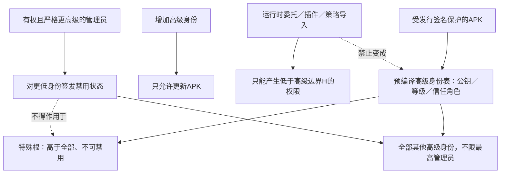

# 高级管理员预编译与禁用 · R13／R31／R32／R35 · R3



```text
普通能力控制：EffectiveLevel >= RequiredLevel
禁用关系：ActorLevel > TargetLevel AND TargetRole != ROOT
高级准入：HighTrustPrincipal ∈ CompiledHighTrustSet(APK)
新增高级：只能 PackageUpdate；不存在 runtime.addHighTrustPrincipal 能力
动态委托：GrantedLevel < H；不能触及需要高级信任的能力

H/具体档位/高级信息字段：Q13待确认，不把“中级”字样当绕过理由。
```

| 操作 | 规则 | 状态 |
| --- | --- | --- |
| 验证高级身份 | 核对预编译公钥与权限记录，再验证请求证明 | 机主要求；实现未开始 |
| 增加高级身份 | 必须发行新的签名APK；Root也不运行时添加 | 已确认O14 |
| 禁用更低管理员 | 必须严格更高；不是普通能力的同级可控规则 | 已确认O14 |
| 禁用同级／更高 | 不满足“更高禁更低” | 已确认关系边界 |
| 禁用Root | 任意发起者、策略导入、状态文件均不可使Root被禁用 | 已确认O14 |
| 恢复被禁用身份 | 恢复者/持久性/跨设备分发范围未定 | Q16 |
| 改高级等级/公钥/角色 | 属预编译身份信息，不得通过可变配置伪装成新增 | 设计约束；字段范围Q13 |
| 改设备白名单 | 继续保留根与各最高管理员隔离；设备新增是否只经APK更新 | Q13关联边界 |
| 公钥持有人来自不同程序 | 不改变同一身份的级别、禁用状态或白名单域 | 已确认O14 |

**一致性审查：** 统一能力注册不表示Root可热添加高级身份；插件也不能把敏感能力改报为低阈值。该包更新边界属于产品信任结构，不是等级足够后隐藏增加的来源限制。
