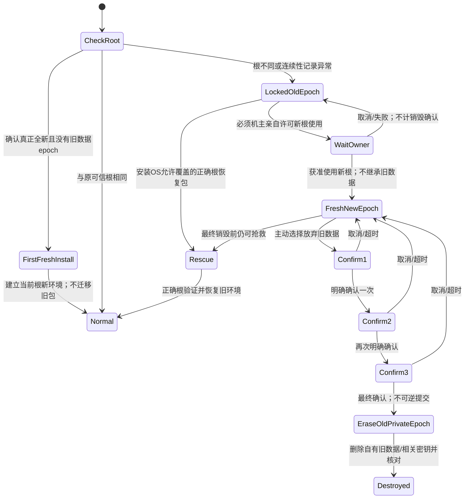
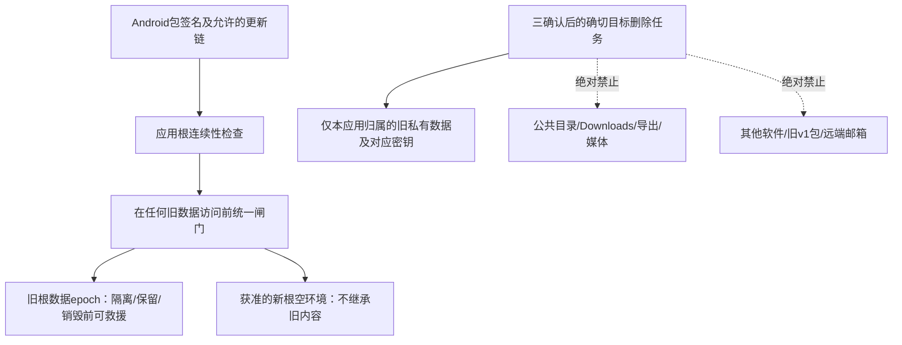

# 根连续性、数据隔离与抢救 · R33／R34 · R3

> 图中的独立首次许可、连续三确认、取消清零是**Q15待确认提案**；不是擅自把“3次确认”解释为“三次启动”。只有机主明确授权的最终销毁提交才可进入删除。Root/其他管理员不能用普通免确认名单替代本专项的亲自许可。

| 安全目标 | 平台事实／设计边界 |
| --- | --- |
| 防恶意开源分叉冒充发行包 | 不同签名通常不能原位替换同包并继承UID数据。首次安装没有旧根基线，仍须可信发行来源/证书验证。 |
| 应用根身份自检 | 是附加一致性机制，不是防御任意同签名恶意代码的万能保证；持发行签名且可修改代码者可以删除自检。 |
| 根身份相同 | 不以字符串ID相同当证明；公钥指纹或可信换钥链的定义待Q14决定。 |
| 不继承旧数据 | 先闸住旧Gecko profile、邮件DB、后台任务、插件/IPC等；不能先启动内核改写旧目录再显示提示。 |
| 正确包抢救 | 必须在最终销毁前保留数据及所需密钥；恢复包须满足签名/合法轮换和不降版本约束，不能承诺直接装旧低版本。 |
| 彻底销毁 | 针对授权的自有旧数据集合：逻辑删除与适用时密钥销毁；不能承诺覆盖闪存物理残留或未受应用控制的系统备份。 |
| 取消／失败 | 不算继续强行使用，不靠时间或启动计数触发擦除；最终授权前保留救援。 |
| 私有范围 | 不使用pm clear，不递归整个设备/共享目录；旧v1应用、公共导出及云端数据不在目标内。私有外部目录边界Q17待定。 |
| 销毁后 | 若唯一解密密钥已销毁，不再声称正确包可以恢复；不可逆点必须明确提示。 |

**这不是旧数据迁移：** 仅新包`io.github.rebrowser`的v2后续根连续性。v1仍保留，禁止借机读取、搬运或清理旧包资料。

[结构化状态与不变量](../records/root-continuity.json) · Q14／Q15／Q17未解决前不实现任何删除代码。
