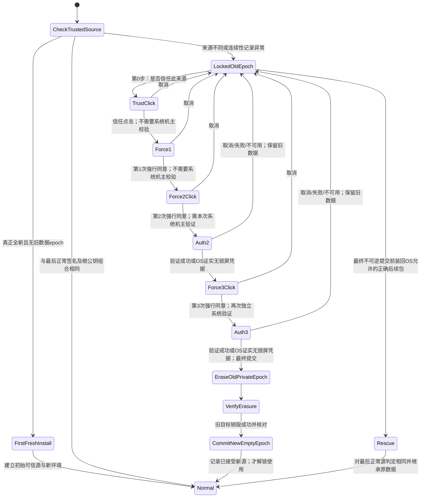
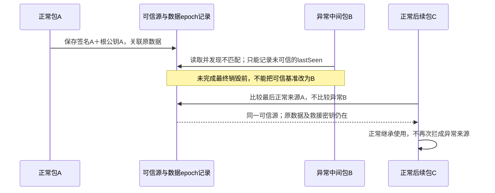
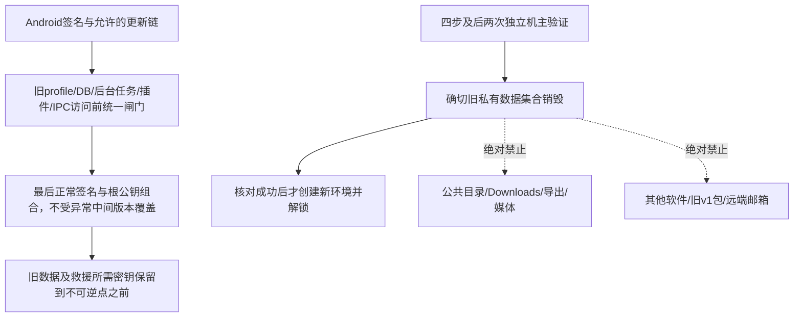

# 可信来源跨版本保持、四步确认与私有数据保护 · R33／R34／R36–R38 · R4

## 当前实现切片（R36，以下状态图仍为总体设计）

`continuity/LastGoodSourceStore.java` 已实现最后正常来源的216B元数据账本：候选B始终保留A的签名/Root/epoch，只有原生协调器显式记录已核验空epoch后才允许替换；破坏可能开始后不接受简单撤回。文件锁、精确快照CAS、私有stage/fsync/仅原子rename/目录fsync/读回，以及异常stage、损坏/缺失marker、目录身份变化的拒绝，已有17项真实HOST临时文件系统测试。

**这些测试没有执行Android文件系统、系统认证、实际擦除或跨APK救援。** SHA只检错；记录中的进度是原生调用者声明，不是本人同意或擦除证据。Missing不代表首次安装，必须另查旧数据清单。完整ContinuityCoordinator、实际四步UI/两次票据消费、精确擦除核验与业务解锁仍未实现；当前正式Root未配置、业务锁定。bootstrap账本/锁目录必须在旧epoch擦除期间保留至新来源提交，不能随普通数据递归删除。



| 步骤 | 机主动作 | Android机主身份校验 | 旧数据／业务状态 |
| --- | --- | --- | --- |
| 0 信任来源 | 直接点击同意 | 不需要 | 仍锁定；不读写旧资料，不解锁 |
| 1 首次强行使用 | 直接点击同意 | 不需要 | 仍锁定；不销毁 |
| 2 第二次强行使用 | 点击＋独立验证 | 每次新系统请求：密码/PIN/图案或合适生物验证 | 成功才计入；失败/取消保留 |
| 3 最后强行使用 | 点击＋再次独立验证 | 不复用第2步成功；每次新系统请求 | 成功后才提交确切私有旧集合销毁 |
| 销毁与核对 | 应用执行已获授权任务 | 非额外的一次确认 | 成功前不解锁；失败明确恢复/保护状态 |
| 解锁 | 新空环境使用 | 四步已完成 | 旧数据不可找回；新源基准只能在成功切换提交时建立 |

**唯一免系统验证条件：** OS明确确认设备没有设置锁屏凭据。设备有锁但生物不可用时应走锁屏凭据；缺硬件、失败、取消、状态未知或超时都不能被当作“没有密码”。应用只接收系统验证结果，不收集锁屏密码或生物模板。

四段警告原例集中保存在[结构化记录](../records/root-continuity.json)的`ownerExactWarningExamples`及O16原话，避免多份文案独立修改。前两步无需系统验证不等于Root/插件可代替后两步的机主验证，也不等于先开放业务。

## 可信源不是“紧邻上一个包”



```text
SourceIdentity = (TrustedApkSigningIdentity, RootAdminPublicKeyIdentity)
AuthoritativeBaseline = lastKnownGoodSource bound to preserved data epoch
lastSeenPackage / lastInstalledAbnormalSource != AuthoritativeBaseline

A正常 → B异常 → C同源正常后续（最终销毁前）：C认A，恢复A数据。
A正常 → B完成四步并销毁 → C：不得承诺已毁旧资料可恢复。
仅成功完成销毁与新epoch建立后，才可提交已接受新来源的后续基准。
```



| 边界 | 事实／验收 |
| --- | --- |
| 签名保护 | 不同签名通常不能原位替换同包并继承UID数据。真正首次安装没有历史源；仍须可信发行来源/证书验证。 |
| 正确后续包 | 必须满足Android签名/合法轮换与非降版本条件；使用可正常覆盖的新版本验证A→B→C，不承诺强制装旧低code包。 |
| 自检的能力边界 | 任意同签名恶意代码可删除自检或破坏记录，不能承诺软件独自抵御已失守的发行签名；这一风险不因四步流程消失。 |
| 没有旧标记但存在旧数据 | 锁定保留，不当作全新安装重新信任，更不自动擦除。 |
| 连续确认 | 取消、失败、超时、关闭、启动次数不是同意；中断保守重置进度，保留可信源/旧数据。 |
| 最终不可逆点 | 最后警告后才可提交；密钥销毁/文件删除后不可找回。不能一边称已彻底销毁，一边承诺正确包仍可救。 |
| 范围 | 只授权的本应用私有旧集合；不使用pm clear，不递归公共/共享/其他包目录；Keystore只可能涉及对应自有数据密钥，具体清单Q17待定。 |
| 新v2与旧v1 | 这是新包v2后续更新的来源连续性，不是旧`io.github.reoutlook`资料迁移或删除。 |

Q14／Q15语义已由O16确定。签名与基准的实现验证见Q18；逐步Android机主验证见Q19；实际销毁集合/恢复版本策略见Q17。**仍未实现任何删除或设备身份验证代码。**
