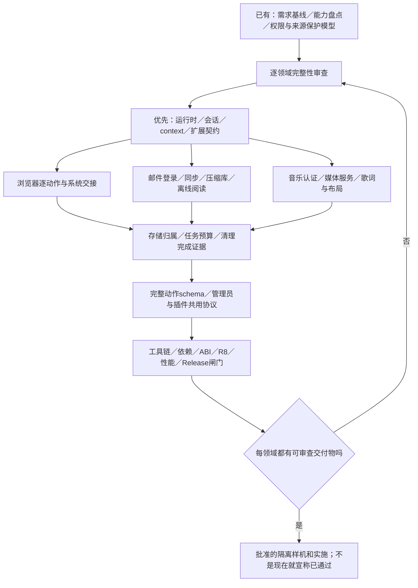

# 实施完整性看板 · R33

O41后允许[完成本文件调研的节点](../records/implementation-readiness.json)先实现；按O45主线转主程序/管理员代码；35源码（22 HOST/13 API-WIP）实际主工程Gradle编译/清单和174HOST测试通过，1033项独立JSON对照保留，不把它们标成A10/A11或整体领域完成。未决权限/逐动作schema/准入/Android仍分别阻断其自己的集成。

**结论：整体规划未完成。** 原话/总体骨架和来源保护模型较充分，不代表浏览器、子应用、内核、数据和发行设计已经可实施。

| 领域 | 当前程度 | 尚缺的实质交付 |
| --- | --- | --- |
| A00 需求/原话 | 已有可追溯基线 | 持续追加；不是整个系统设计完成 |
| A01 用户旅程/屏幕 | 原生主程序/内部控制台已开始编写和编译，完整界面待接入 | 逐屏导航、返回优先级、首次新包体验、错误反馈与无障碍 |
| A02 Gecko生命周期 | 实际PartitionCatalog/GeckoSessionOwner/SessionDisplayBinding与惰性BrowserCoordinator已写，纯类HOST/Native API分层 | 真实初始化/A04期限/委托/有效checkpoint恢复、原生运行与预算实证 |
| A03 浏览器领域 | 实际双层工作区/标签与SearchEngines/ExternalNavigation已写，Native选中/revision后loadUri代码；模型/输入31项HOST | 主窗口/Native委托和实际URI行为、持久BrowserStore/恢复、收藏/历史/原生页面接入及批准界面验收 |
| A04 系统边界 | 原生API/固定模块HOST检查，真实权限期限仍阻断 | EXPIRE_NEVER有限许可撤回；COARSE provider≠站点坐标隐私；global pause≠单站活动停止，需JNI/OS实证 |
| A05 扩展通信 | 本轮契约草案 | main-world/API可用性、消息分块、实际异步取消验证 |
| A06 Outlook | 概念状态机 | 官方入口与Popup/同步协议/账户隔离/完整恢复动作 |
| A07 离线邮件 | 对象AEAD/原文codec私有管线已写并HOST通过；SQL/账户/事务/安全阅读仍缺 | schema/写读事务/索引/codec容器/去重与压缩基准 |
| A08 Music | 功能与硬规则盘点 | 官网SDK与Gecko媒体分工、服务/回调/歌词具体设计 |
| A09 存储 | API缺口已识别 | 可落地归属、可用估计、回收/删除结果判据与事务 |
| A10 控制协议 | 原生控制台/帧/验签/真实challenge/原生SQLite幂等账本已写，原生TaskJournal/request-task同事务/CommitFence和4项ActionSchemas已写，内部控制台已接参数校验；未完成真实策略协调器/效果调度，未执行命令 | 逐动作schema、幂等/取消/隐私返回、等级映射完全一致 |
| A11 密钥/名单 | 规则已确认、实现设计未齐 | 真实材料保管、登记工具、预编译表/禁用分发与恢复 |
| A12 来源保护 | 自身签名/Root、精确确认文案与OwnerAuthentication Android源码已写，Startup仍锁定；HOST只有元数据/绑定，无OS验证或票据消费 | LastGood/epoch、真实四步协调/本人验证与消费、实际签名轮换/救援、精确销毁不可逆点的实现与验证 |
| A13 资源预算 | Cancellation状态原语已写并有真实HOST并发证据；全调度仍缺 | 调度、线程、峰值、低内存、取消和性能判据 |
| A14 构建发行 | 上游元数据/POM | AAR/ABI/minSdk/工具链、许可、依赖/R8/签名与包体 |
| A15 验收执行设计 | 用例盘点 | fixture/步骤/可观测断言/异常注入/矩阵与发行阻断 |

## 每个领域的完成定义

| 必须交付 | 不算完成的替代品 |
| --- | --- |
| 输入/输出/状态/动作/所有权/持久化 | 一个模块框或一句“支持该功能” |
| 正常/失败/取消/重建/并发顺序 | 只有顺利路径 |
| UI动作→领域动作→管理员能力→验收映射 | 一条“全部功能可控”概括 |
| 线程/内存/时间/队列预算与测量办法 | “尽量优化”“有界”但没有约束 |
| 官方API证据或明确待验证假设＋撤回条件 | 把能力想象成Gecko已经提供 |
| 数据范围、隐私、风险和恢复界限 | 先写代码后补安全 |
| 验收输入、步骤、预期状态与失败阻断 | 测试条目数量或符号演算冒充真机通过 |

[权威完整性账本](../records/completeness.json)包含每领域责任、缺口、交付与推进顺序。普通工程问题由助手负责，不把未研究完的事项全变成机主问卷。旧私钥实体交接、真实资料不可逆操作等需要材料/授权的事项才在相关阶段提出。
