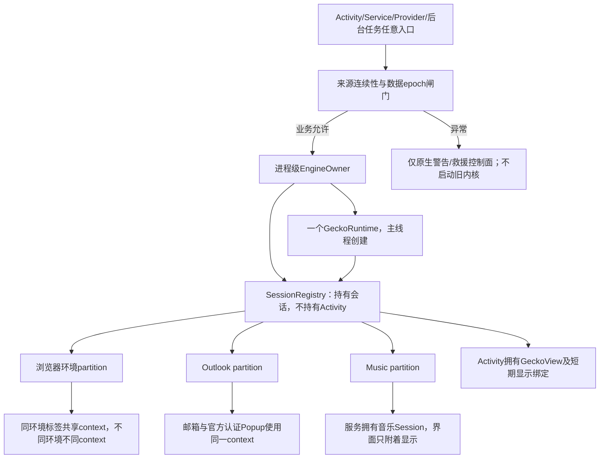
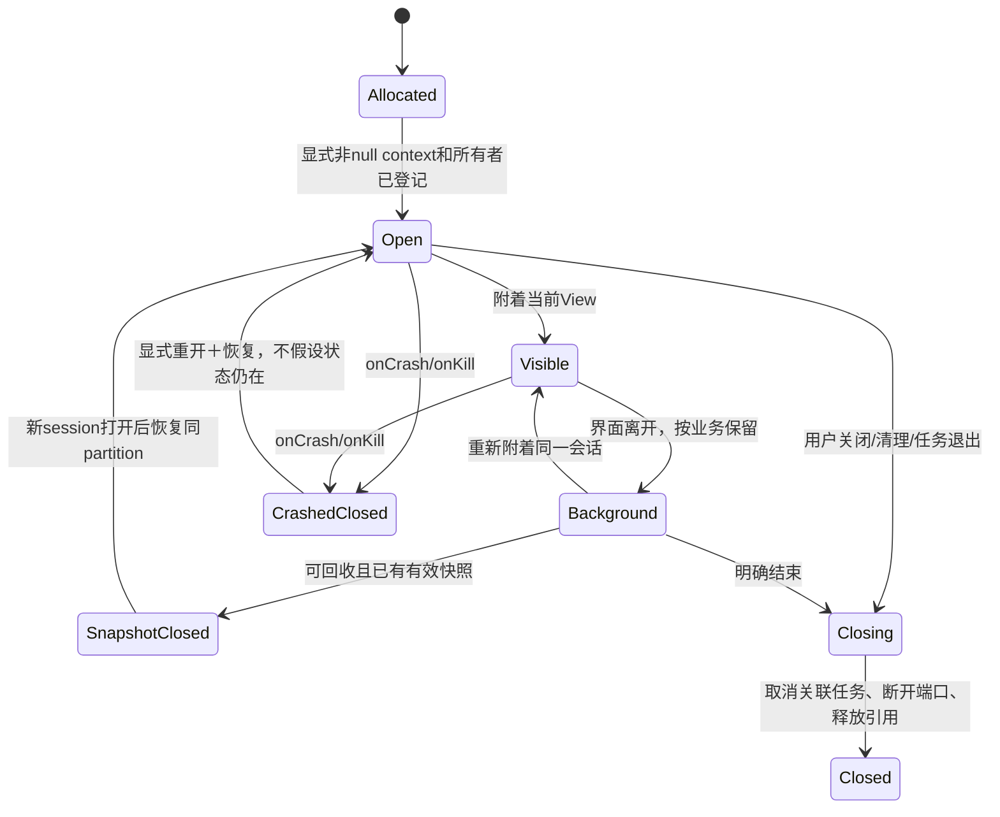

# Gecko运行时与会话蓝图 · A02／A05 · R5候选设计

> 这是具体候选，不是平台验证完成。默认方案为**主应用进程中的单个GeckoRuntime＋明确context的会话注册表**；不能因每个子应用都想统计容量就默认各启动一个重型内核。E13已确认引擎仍有media/socket/gpu/content等内部子进程，单runtime绝不是“整个应用只有一个OS进程”。



| 对象 | 唯一所有者 | 生命周期 | 持久化与不变量 |
| --- | --- | --- | --- |
| EngineOwner/runtime | Application级进程所有者 | 通过来源闸门后按需创建；不是Activity重建一次建一个 | E07：已有活Gecko实例时create会抛错；shutdown使所有session失效 |
| PartitionRecord | 领域存储注册表 | 显式创建/保留/退休；不因某个View退出而删除 | 不含邮箱/设备资料的随机稳定ID；记录业务归属、context、数据epoch、清理任务 |
| Browser session | 浏览器会话注册表 | 创建/可见/后台/挂起/恢复/关闭 | 一环境一context；标签强引用；状态快照按敏感资料保存，不导出到普通诊断 |
| Mail session | Outlook会话所有者 | 邮箱/登录/Popup流连贯；UI切换不是注销 | 同一官方登录上下文；不在onPause清context；正常恢复不伪造认证状态 |
| Music session | 音乐领域服务 | Activity可离开，合法后台播放仍由服务维持 | 正常冷重建不自动起播；服务关闭才释放；不持有旧Activity |
| GeckoView/display | 当前Activity/View容器 | 只负责附着/分离 | 不决定context身份或创建另一个runtime |
| Bridge request | 指定session＋文档代次＋请求ID | 真正完成/明确取消/文档消亡 | 超时不假装实际异步操作已结束；旧回调不能写新会话 |



## 已核实的API契约与设计影响

| 证据 | 事实 | 必须落实 |
| --- | --- | --- |
| E07 | runtime绑定进程，已有活实例不能再create；shutdown关闭全部session | 进程级唯一创建入口；子应用关闭不能shutdown整个共享runtime |
| E08 | contextId默认null无此隔离；不同ID分隔cookies/localStorage且持久化 | 所有业务会话显式非null ID；不能用遗漏设置制造邮件/浏览器串登录 |
| E09 | onNewSession返回新session，强引用保持；不要在回调自行load参数URI | Popup工厂先绑定来源partition与父session，再交给引擎加载，防双加载/错误context |
| E10 | onCrash/onKill后session已关闭；重新open不自动恢复状态 | 崩溃代次作废，显式restore/reload；不能拿旧ready或媒体句柄继续用 |
| E13 | AAR声明引擎内部子进程与service | 主进程才创建EngineOwner；其他进程初始化不得再建主runtime/邮箱库/播放服务，来源闸门覆盖所有数据入口；资源统计覆盖进程组 |

## 持久ID与恢复记录提案

```text
Partition: id, ownerDomain, kind, contextId, dataEpoch, retentionPolicy, lifecycleState
Session: id, partitionId, ownerType, parentSessionId?, generation, lifecycleState, lastSnapshotRef?
Snapshot: sessionId, partitionId, dataEpoch, revision, encryptedStateBlob, capturedAt
Task: requestId, sessionId?, documentGeneration?, partitionId, cancellationState
```

- 恢复只允许相同partition/dataEpoch的快照；不把快照成功等同网站仍登录。
- 清理先fence再关目标所有会话；context删除返回void这一缺口仍在。可退休context防重用旧数据，但**退休不等于磁盘删除完成**，不能偷换清理成功。
- 页面回收不得回收正在输入的登录、明确播放的音乐、活下载/未决权限交互所需会话；具体预算待A13设计及低内存验证。
- 默认不主动warmUp；只有来源闸门通过、实测收益明确且资源预算允许才启用，避免原生设置页也启动引擎。

## 可撤回条件／实验

| 默认方案 | 要验证 | 失败处理 |
| --- | --- | --- |
| 单runtime＋context隔离 | cookies/DOM/第三方认证/媒体生命周期隔离；恢复不串区 | 先定位API/委托错误；必要时比较额外进程方案及其RAM/启动代价，不盲开三内核 |
| 共享内核缓存单列 | 是否有安全context级缓存清理与完成证据 | 不以全局清理假扮子应用；能力缺口如实处理，不阻断其他业务 |
| 同context官方登录Popup | 新窗口/返回/取消/重定向真实行为 | 修正状态与路由；不复制Cookie、不创建假认证页面 |
| 原生显式快照恢复 | session崩溃、进程重建、旧回调迟到 | 有界重试、真实失效重登录；不恢复自动播放授权 |

下一交付：逐个delegate/扩展API参数与线程契约、恢复场景数据及P1实验脚本设计。仍不是已实现的引擎层。
