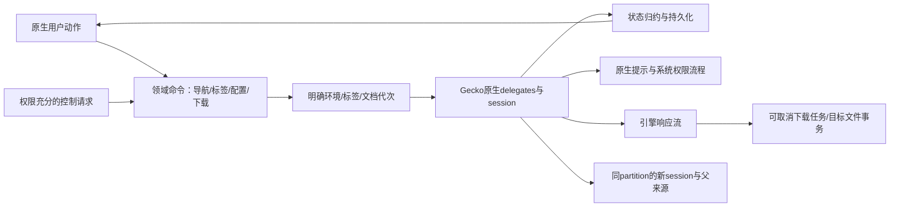
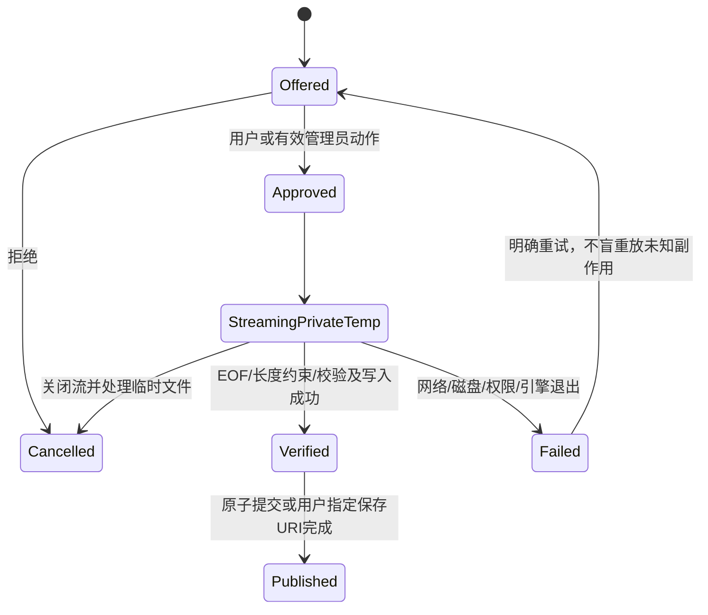

# 浏览器与系统边界设计骨架 · A03／A04 · R5

| 功能 | 具体命令/状态 | Gecko或系统路径 | 失败／恢复要求 |
| --- | --- | --- | --- |
| 环境与标签 | Create/Select/Rename/Close/Retain；独立partition与子标签 | session/context注册表，不模拟WebView的Profile对象 | 不同环境不串数据；临时环境退休/删除区分；切回不借其他环境 |
| 导航 | Load/Back/Forward/Reload/Stop；loading/error/committed | NavigationDelegate＋ProgressDelegate | 请求代次区分；重定向/错误不重复历史记录；网络错不清登录 |
| Popup | Request/Create/Attach/Close/ReturnToParent | onNewSession按E09创建新session | 新窗必须继承正确partition；不能重复load或被GC；关闭回原来源 |
| 新标签/搜索/收藏 | 原生页面/搜索提供者配置/收藏与环境书签 | 原生View＋领域数据；输入后明确选择目标session | 保留已有交互，不因换内核引入大UI框架/额外库 |
| 历史 | 写入/暂停/维持/期限/查询/清理 | 以已提交导航事件为依据；原生数据模型 | 不把中间OAuth/重定向全当普通访问；敏感URL不写普通审计 |
| 下载 | Offered/Approved/Streaming/Complete/Cancelled/Failed | 优先使用引擎提供的WebResponse流；onExternalResponse契约需P1验证 | 不把鉴权下载重建成无上下文HTTP；流式写临时文件，完成后原子提交 |
| 下载取消/删除 | CancelTask/DeleteExactTarget | 取消引擎/关闭流/撤销临时文件；公共保存需用户给出的URI授权 | 只删明确用户目标；普通下载删除与来源保护“只删私有旧数据”是不同作用域 |
| 文件选择 | Prompt/Picker/Pending/Selected/Cancelled | PromptDelegate→系统选择器/ContentResolver | activity重建/取消不留未决回调；不给网页任意路径读取 |
| 网站权限 | Ask/Grant/Reject/Expire；context＋origin＋能力 | PermissionDelegate与Android权限分层 | Android授权不等于全网站授权；拒绝单能力不使软件不可运行 |
| 剪贴板 | 明确用户输入动作或授权管理员能力 | 优先原生Gecko权限/提示；实际OS资格要求照实处理 | 不在网页加载时偷读；旧点击不能绑定新文档；后台OS限制不是管理等级不足 |
| 外部链接 | UserRequested/Redirect/Handled/Rejected | NavigationDelegate→明确原生handoff | 外部HTTPS仍遵守临时隔离环境规则；非HTTPS背景跳转不擅自拉起其他软件 |
| 默认浏览器/安装器 | OpenSystemFlow/Pending/UserCompleted | Android Role/系统安装界面 | 管理者能发起同一流程，不能假称已获OS角色或绕过签名/用户决定 |
| 全屏/返回 | fullscreen→浮层/提示→网站层级→标签/应用退出 | ContentDelegate及原生窗口控制 | 同步真实页面全屏状态；不写系统旋转/音量/DND来伪装成功 |

## 下载事务提案

| 数据模型候选 | 设计约束 |
| --- | --- |
| WorkspaceRecord / TabRecord / NavigationRevision | 稳定ID不含账号信息；父Popup来源与partition显式记录；事务写入 |
| Bookmark / HistoryEntry | 与现有用户能力逐项对应；新包无旧数据库兼容负担；不因此丢历史功能 |
| DownloadTask / SaveTarget / ContentDigest | 不在普通日志保留Cookie/鉴权URL；归属、临时文件和公共URI分别表示 |
| SiteGrant | origin＋partition＋能力＋期限＋前后台条件，不是全局许可开关 |
| PendingPrompt | session/document/request绑定；一次结果；拒绝/取消/销毁都有结束路径 |

**尚缺：** 每条命令最终schema、各delegate精确字段与线程、公共下载重启续传能力、完整返回层级对照数据、真正Release测试。此表是任务设计骨架，不是把几十个子项一句“全部支持”就标完成。
