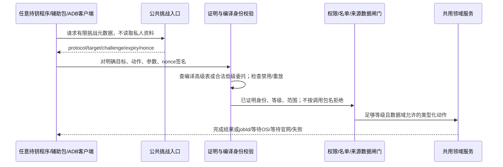
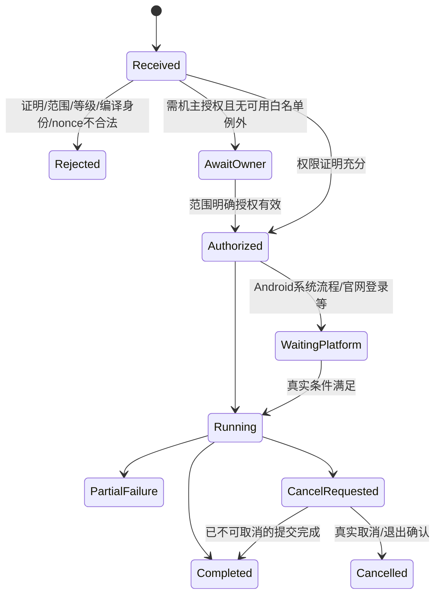

# 统一控制协议与执行契约 · A05／A10 · R5候选

## 程序来源中立，身份与权力证明明确



| 部分 | 候选字段 | 不变量 |
| --- | --- | --- |
| 协议域 | protocol=`rebrowser.control/1`、appId、schemaVersion | 新包协议不装成兼容v1管理员协议；旧CLI维护线另保留 |
| 请求身份 | keyId、proof、必要的低级委托链 | 高级公钥/等级只能预编译；低级委托等级<H；等级不由客户端自报 |
| 目标 | installation挑战、dataEpoch、capabilityId、objectId | 防跨包/跨设备/跨旧epoch重放；这是目标绑定，不是限制调用程序来源 |
| 参数 | 明确类型、长度与动作schema | 拒绝重复字段/多余字段/隐式类型转换；不能用插件参数修改高级门槛 |
| 请求新鲜度 | requestId、nonce、challengeId、expiry | nonce一次性；不能只凭shell UID或一个静态口令获得管理员身份 |
| 会话 | grantId、目标范围、有效期/撤销版本 | 机主授权只能激活已有身份可获得的权限，不能热加高级身份 |
| 执行结果 | status、jobId、progress、typedError、resultDataRef | 已提交/完成/部分失败/等待系统/等待官网明确区分，不把等待登录叫等级不足 |

## 签名字节与幂等候选

```text
签名对象 = 固定协议域标签 || 明确长度的目标/nonce/动作字段 || 参数原始字节
验证收到的原始字节；不依赖JSONObject重新序列化的字段顺序。
UTF-8解码严格、长度有上限；重复JSON键、未知字段和类型混淆拒绝。
具体字节编码/跨语言测试向量仍需完成，不为方便引入大协议库。

(requestId, principal, target, parametersDigest) -> one execution/job
同ID同证明内容的合法重试：返回原结果/任务，不再次执行副作用。
同ID不同内容：拒绝。
身份已禁用/授权过期后：不能仅凭旧ID重新取得敏感结果。
```



| 入口 | 接入方案候选 | 边界 |
| --- | --- | --- |
| ADB有线/无线 | 同一签名协议，经shell调用薄适配器 | 不以DUMP/shell身份代替管理员证明 |
| 跨应用/辅助包 | 公开的受认证Binder/Provider控制端 | 不能整体要求调用者与主包同签名，否则违背持钥来源中立；未认证只暴露有限挑战元数据 |
| 主/子应用内部 | 同一领域接口与策略，不复制一套特权实现 | 机主正常UI动作身份和管理员身份不同，最终领域状态一致 |
| 动态插件 | 外部进程/辅助包/受控扩展/RPC工作流 | 不默认在主进程加载任意DEX/原生机器码，否则中级插件可绕所有守卫 |
| Gecko业务连接器 | APK内固定应用扩展、会话/帧/文档绑定的类型化消息 | 普通网页业务消息不因来自官方域就成为管理员证明；有效管理证明走统一控制层 |
| 大结果 | 有界流/一次性结果引用/明确隐私级别 | 不把全邮箱/截图/令牌无界塞进主线程Bundle或普通日志 |

## 必须完成的后续规范

- 每个动作拆到实际参数、返回、风险、幂等、取消及异常恢复，不止当前43组概括。
- 协议字节级测试向量、证明算法/低级委托/禁用记录/信任表版本与防回滚规范。
- 所有权限门槛与高级边界H的一致映射；本文不偷偷改变已确认的≥、更高禁更低、Root不可禁。
- Gecko业务消息与控制消息的独立类型/权限校验、真实main-world/端口API、大小/频率/队列预算。
- 来源异常的四步与两次系统验证是专门数据保护流程；控制请求只能发起界面，不能伪造本人同意或提前解锁。

**当前状态：契约草案，未实现接口、未开放监听、未加载插件、未生成密钥。**
