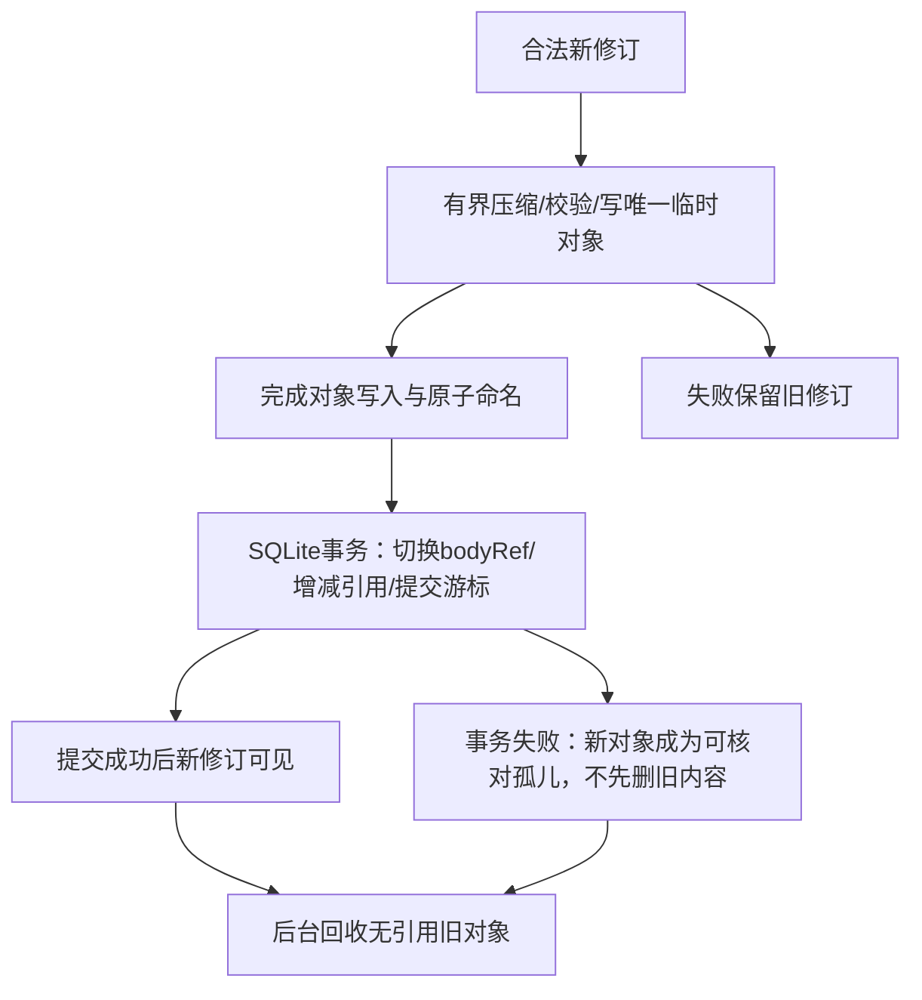

# Outlook登录、同步与压缩离线库初稿 · A06／A07 · R5

## 登录入口与会话

| 场景 | 设计选择 | 必须验证 |
| --- | --- | --- |
| 新包首次、没有成功入口记录 | 不从邮箱域名猜AAD/MSA；优先一次明确个人/工作学校选择 | P1核实是否有官方通用入口可省去选择；不拼私有OAuth参数 |
| 已有正常会话 | 打开同partition/context，恢复界面后核对官方会话证据 | 不因onPause/换屏/状态未知清Cookie或重新开认证context |
| 登录窗口/重定向 | 官方流程、同context Popup；网页表单/验证码由用户完成 | Gecko新窗口回调与返回父页正确，不重复load |
| 已知启动错误 | 分为入口/会话/网络/服务等错误；有界恢复，给出正确入口选择 | AadOrMsaRedirRequired不等于Cookie一定丢失；不得无限个人/工作来回跳 |
| 真正过期/用户退出 | 回官方认证流程，保留本机离线账户资料 | 不把历史登录或恢复快照当阳性认证 |
| 成功入口记忆 | 仅在真实邮箱有效证据成立后记录最近成功入口 | 失败跳转不能永久覆盖成功入口 |


连接器不在登录密码页采集DOM，不返回原始OAuth凭据；业务采集与管理员凭据体系完全分离。公司身份提供者可正常HTTPS认证跳转，不能因为没有被列为“邮件内容桥”域就禁止整个官方登录；只有真正邮箱域能提交邮件业务消息。

## 数据模型候选

| 实体 | 关键字段 | 一致性 |
| --- | --- | --- |
| Account | 随机nativeId、官方验证映射、partitionId、schemaVersion | 不把空/未知账号激活为默认账号；分区与访问权限明确 |
| MailItem | accountId、officialItemKey、revision、conversationId、headers、bodyRef、flags | `(accountId,itemKey)`唯一；新旧修订有序，旧回调不得覆盖新版本 |
| ContentObject | accountId、digest、codecVersion、originalLength、storedLength、checksum、encryptionRef、refs | 默认账户内去重；不能跨账户错删或泄漏存在性 |
| Attachment | accountId、mailId、ownedFileRef、mime、size、status、digest | 流式下载/取消；已压缩内容不盲压；不把公开导出文件视为可回收私有副本 |
| SyncCursor/Job | accountId、generation、cursor、jobId、commitState | 只推进已成功提交数据的游标；中断可恢复，不重放云端副作用 |
| SearchIndex | 受支持元数据/正文索引策略及版本 | 索引成本计入占用；不以节省空间为由静默删除已有检索能力 |

```text
内容容器：magic/version + codec + originalLength + storedLength
        + checksum + optional keyVersion/nonce/tag + payload
解压按流且有长度/块上限，不根据不受信的originalLength一次分配内存。
所有权：账号 -> MailItem -> ContentObject/Attachment引用；只有无活引用才可回收。
```

## 写入／删除的崩溃顺序



| 压缩／读取选择 | 工程基线，不是未经测试的最终参数 |
| --- | --- |
| 首个基准 | 平台Deflater/GZIP高等级，零新增库；逐正文/块压缩，不重压整个SQLite文件 |
| 高压缩候选 | 只有Zstd等在合成数据上有显著额外节省且内存/耗时/ABI/体积合格才准入；不能仅因算法名好看引库 |
| 去重 | 先按账户内原始内容摘要精确去重；分块引用长会话的收益需数据证明，避免先做复杂通用去重系统 |
| 小数据/附件 | 小记录压缩无收益可原样；JPEG/ZIP等已压缩附件按实际收益选择；计入容器/加密头开销 |
| 加密 | 重点保护正文/附件等敏感内容；密钥分域、流式处理；不能宣称所有Gecko文件都已由应用加密 |
| 搜索 | 元数据快查＋可取消正文检索；平台索引能力验证后再决定；索引/缓存也计入账本 |
| 阅读 | 按需解压、有限缓存；不把整个邮箱载入内存，不在主线程做高压缩 |
| 离线HTML | 使用独立只读/隔离阅读会话或原生安全呈现；禁邮件脚本/表单/同邮箱Cookie访问；远程内容有明确用户策略 |
| 清缓存/清数据 | 唯一离线正文不是普通可重建缓存；清全部数据才明确覆盖这些唯一副本 |

R8已补充[具体实体/事务与合成主机基线](20-mail-storage-and-codec-evidence.md)：小payload默认内联SQLite，大对象才独立文件；压后不够节省保持RAW，不把每条正文一文件作为默认。主机既有Zstd只是对照，未加入产品依赖。它不证明Android性能或完整邮件库已实现。

**下一交付：** 完整SQL约束、加密/codec容器字节格式、Android检索/压缩预算、官方同步消息与损坏/中断fixture。没有迁移旧DB或读取真实邮箱作基准。
