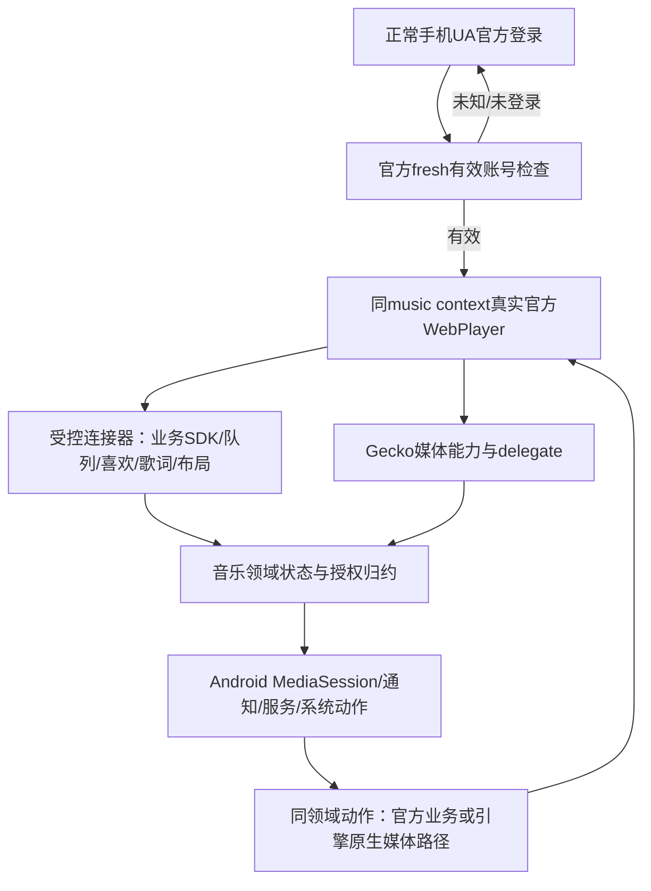
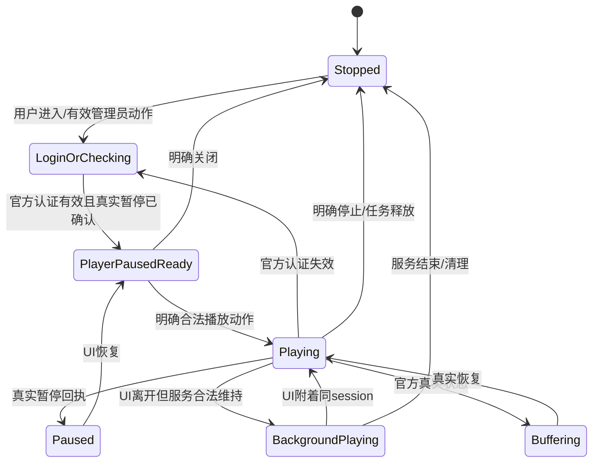

# 音乐的Gecko原生分工与生命周期初稿 · A08 · R5

| 责任 | 不应混淆的边界 |
| --- | --- |
| 官方网站/SDK | 决定真实账号、资源、权益、队列、喜欢、歌词和业务播放状态 |
| Gecko原生媒体 | 承接媒体状态/元数据/位置等可用事件与原生动作；具体158接口仍须P1核对 |
| Android媒体会话 | 统一系统控制、通知、音频焦点与可用动作；不伪造官方进度或授权 |
| 音乐领域服务 | 唯一会话所有者，应用/系统/管理员动作共用；绑定session代次/资源/playId |
| Activity | 当前显示和用户交互，不是后台播放session的生命周期所有者 |
| 扩展连接器 | 仅补官方业务集成与批准布局，不再用高频WebView式整页evaluate轮询替代全部原生能力 |

## 已有用户契约保持

| 行为 | 新实现验收 |
| --- | --- |
| 登录是业务前置 | 未确认/过期不进入业务；不凭Cookie存在或老快照判已登录；用户输入中不定时跳走 |
| UA与窗口 | 默认手机UA官方登录；仅平板＋完整窗口＋横屏且用户主动切换才桌面扫码；进入业务同context |
| 原网页与权益 | 不自造播放器/资源/进度；不提取媒体URL重建播放；网站验证码、版权、试听限制保持 |
| 冷启动 | 恢复界面不等于允许自动播放；保持已批准的冷启暂停与明确起播规则 |
| 系统seek | 与真正业务/引擎回执关联；暂停seek不偷偷播放；不直接伪造timeupdate |
| 旧引擎补丁 | 默认不搬Howler继续播放等旧WebView特有补丁；只有Gecko同问题确证后才考虑有界修复 |
| UI布局 | 保留批准的手机/非全窗口适配及原始网页点击/滚动；真正完整平板横屏原版布局约定保持 |
| 歌词 | 官方有界读取；关闭→拖动→锁定穿透→关闭；位置与权限/锁屏约定保持 |
| 后台/重连 | Activity重建/任务回接不新建第二个播放session；关闭后旧Binder/旧回调不能恢复已停止任务 |

## 推送事件、任务与资源

- 优先Gecko/官方SDK可靠事件；保留有限健康检查和fresh账号校验，但不把全状态高频JSON轮询原封不动搬来。
- 事件/指令带session generation、document generation、resource/playId与requestId；切歌/清理/崩溃作废旧请求。
- 每类实际未完成网络/JS任务有槽，超时不假装原任务结束。封面只保留最新请求，图片解码与缓存受预算限制。
- 服务/音频焦点/前台通知只按真实播放与Android政策维持，不修改音量、DND、系统超时/旋转，不自主唤醒解锁。
- 后台无认证/无播放不因进入原生设置就自动启动业务；普通统计不成为启动音乐的理由。

**尚缺：** Gecko158媒体delegate及动作字段逐项映射、官方SDK与原生媒体动作的唯一调度策略、音频焦点/中断/蓝牙事件矩阵、扩展main-world可用性、歌词/图片预算和真实手机/平板对照。没有音频播放或设备测试发生。
