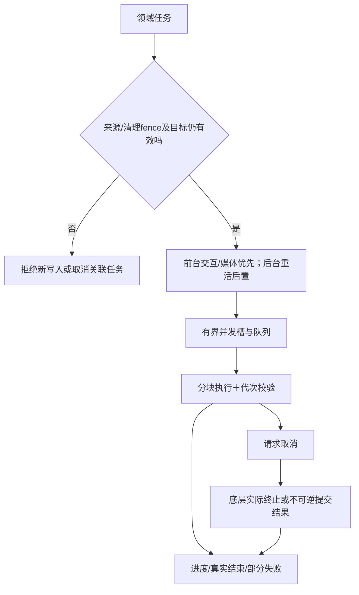

# 线程、任务、资源与依赖预算初稿 · A13／A14 · R5

## 所有数字是初始量测目标，不是已达成保证

| 对象 | 初始约束／目标 | 测量与撤回条件 |
| --- | --- | --- |
| Runtime | 主应用进程一个活实例；Gecko自己的子进程另计 | 不只量Java堆，统计native/content/media/socket/gpu/crash等进程组PSS；按E07/E13规则 |
| 活session | 优先可见浏览器、活音乐、输入中的登录及必要Popup；后台可恢复页面可快照关闭 | 不以后台回收导致退出登录/打断输入；普通标签数量不等于活renderer数量 |
| UI主线程 | 仅UI状态/必要Gecko调用；无高压缩、文件遍历、整库扫描、大图解码或大消息解析 | 事件耗时/帧卡顿追踪；不写系统全局内存策略 |
| 普通IO | 初始最多2个工作线程，有界队列及取消；写入按账户/目标有序；连接器auth/effect/read分槽并保留safety入口 | 低端Android11实测；媒体/前台阅读优先于统计和压缩 |
| 压缩 | 初始1个后台工作槽，分块/逐正文；不加载整个邮箱 | 比率、压缩/读取耗时、峰值内存、取消响应；高等级不合预算就调整 |
| 管理控制元消息 | 初始64KiB量级；大数据另走有界流/分块 | 限每消息而不是把“数据大”变成能力缺失；签名/解析长度验证 |
| 网页业务数据 | R7按[协议预算](../records/connector-protocol.json)采用32KiB原始块、64KiB消息/信用窗，明确长度/序号/代次 | base64后仍留封装空间；大合法内容分块落盘，不截断或先拼巨型字符串 |
| 歌词/封面 | 文本和图片像素/缓存明确上限；只保留最新封面任务 | 原功能足够显示；不积压迟到任务，低内存可降缓存而非丢权限 |
| 统计 | 后台遍历/账本快照，批量更新，不依赖活网页或阻塞设置页 | 2/50/200MB量级准确度；显示范围/时间/共享部分 |
| 交互反馈 | 长任务先在约500ms内显示状态，取消请求尽快反馈，真正取消单独确认 | 不能用“已请求取消”冒充底层工作已停止 |
| 启动/阅读 | 分开记录原生壳、闸门、引擎就绪、首帧、官网交互；离线列表/正文单独计时 | 不把网络耗时伪装宿主性能；冷暖/低内存/Release实际包都测 |

## 依赖与工具链策略

| 项目 | 初始工程选择 | 仍待验证 |
| --- | --- | --- |
| UI/语言 | 优先继续Java与原生Android View，GeckoView直连领域层；不为换内核自动引入Compose/DI大框架 | Gecko158传递依赖、AGP/D8/R8/compileSdk兼容性 |
| Gecko | 精确stable158锁定，自带内核，不查系统WebView；已核实manifest minSdk26 | 产品最低仍API30；真实许可/native体积/无GMS局部降级及驱动兼容继续验证 |
| 密码学 | 平台JCA/Android Keystore优先；管理员/设备/发行/数据密钥分域 | 每用途算法/签名字节向量/恢复材料；不能生成后假称已保管 |
| 认证页面 | 官方网页流程，不为已有网页登录额外加一整套原生第三方OAuth SDK | 官方入口/Popup/浏览器兼容性实测 |
| 邮件库 | 平台SQLite与压缩为基线；不默认引Room/SQLCipher/多种codec | 有必要才引单项库，并计入APK/内存/许可/安全维护 |
| 多进程/模块 | 逻辑边界先清楚；不为架构外观拆大量空Gradle模块/多内核进程 | 实际编译/运行/测试成本与收益 |
| 构建工具链 | 官方AAR已要求minCompileSdk37、minor2；旧compileSdk36不能直接沿用 | 准备能支持37.2的SDK/AGP/D8/R8组合；不是要求用户升级到Android37 |
| ABI与发行 | 官方AAR含arm64-v8a/armeabi-v7a/x86_64；默认含背景全量覆盖这些ABI | 没有32位x86，不能无依据承诺支持；不自动降旧Gecko。未跑真实ABI设备测试 |
| 包体裁剪 | 不未经证据删Gecko.so/传递库；R8裁Java/Dex不等于裁C++引擎 | 自带多ABI内核带来体积增长，先测量；若未来需额外分发资产要说明收益 |
| 正式包 | R8/资源收缩/必要keep/选择性重要数据加密；实际Release回归 | JNI、回调、扩展消息、启动、登录、播放、离线检索不能只Debug可用 |

## 失败与过载策略

- 队列满：合并可覆盖的最新状态请求；不悄悄丢邮件写入或不可逆管理员动作；返回明确忙碌/可重试状态。
- 低内存：丢可重建图片/页面缓存、保存可恢复会话；保留正在输入登录与合法后台音乐，不通过杀其他软件解决。
- 慢盘/存储不足：停止新增大任务、保留已提交数据、清理自有未引用临时对象；不扫公共目录/其他包找空间。
- 进程死亡：任务日志+原子提交恢复；源变化业务闸门先于任务恢复，不误开旧数据。
- 日常设备：任何带真实资料的清理/破坏性验证都需要明确授权；性能实验先合成数据/隔离环境。

[AAR元数据证据](../evidence/aar-metadata.json)与[兼容性矩阵](../matrices/compatibility.csv)来自有界HTTP范围读取，未下载完整AAR，未完成完整性验签或构建。

本页是预算设计起点。后续会把每个数字的设备、样本、采样点、P50/P95、失败阈值和调整理由填入独立量测表，不能把目标写成结果。
