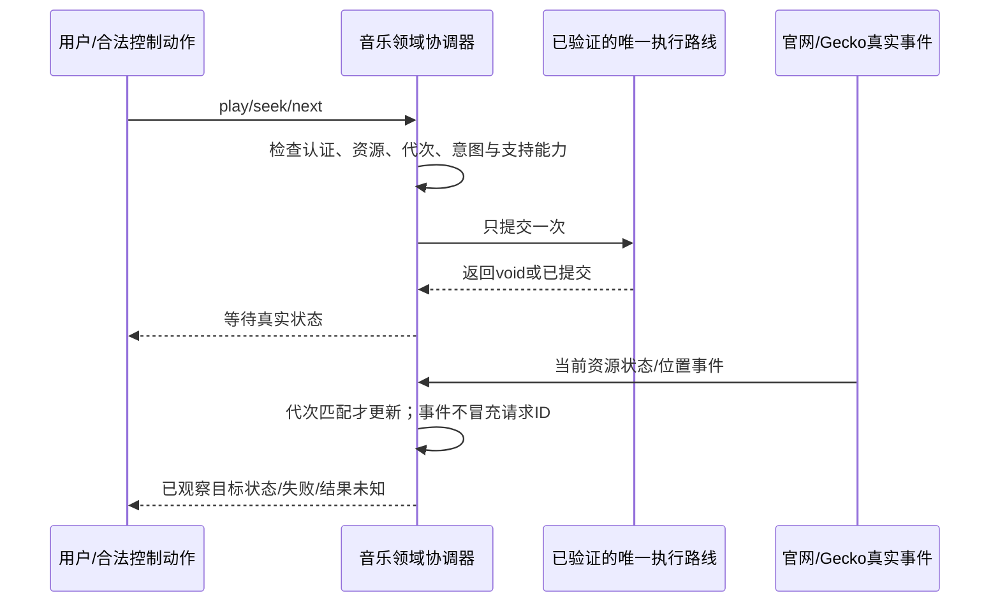

# Gecko集成契约核对 · R6

**本轮已从扩散阅读收束到12项契约与28项验证场景。** 以下为固定stable158源码证据，不是运行通过。权威细节：[集成契约](../records/gecko-contracts.json)；[验证场景](../matrices/gecko-contract-cases.csv)。

## 已足以约束实现的结论

| 范围 | 核实到的事实 | 实现必须怎样改 |
| --- | --- | --- |
| 内建扩展 | ensure按ID/版本，不按内容哈希重装 | 修改连接器内容必须提升manifest版本；等安装/delegate就绪再开业务页 |
| 网页消息 | content delegate按session；后台sender.session为空；Java sender没有documentId | 不信payload自报标签/账号/帧；文档租约由Native登记，导航/恢复必须协商 |
| Port | UI线程回调；本地disconnect实现不会自动调用自己的onDisconnect | 显式清理本地状态，不死等回调；断开不等于官网工作被取消 |
| 媒体动作 | active＋feature；play/pause/seek/next为void，seek单位秒 | 一次动作选一条已验证路线；等待实际状态，不从方法返回标成功 |
| 媒体事件 | 无每请求requestId，position可能只反映最后报告状态 | 明确“目标状态已观察”，不伪造精确ACK；迟到旧歌曲事件丢弃 |
| 音频焦点 | 系统interrupt与用户play/pause分开；gain可能恢复被打断源 | 恢复绑定有效播放意图/租约；用户pause/stop后旧gain不能起播 |
| View与会话 | releaseSession不关闭，也不自动inactive | View分离、隐藏提示、关闭session、关闭runtime分开管理 |
| 快照 | flush异步void；快照含表单；restore不恢复“已认证”事实 | 快照敏感保存，等合法回调与提交；不因重建自动登录放行或播放 |
| 取消 | GeckoResult.cancel可能返回false | UI取消请求与实际取消分别记录，真实工作槽不因超时提前释放 |
| 下载 | WebResponse.body是必须关闭的流 | 包括拒绝/忽略/失败也关闭；不用默认runtime fetch重建带认证下载 |

## 存储问题找到候选路径，但没有假装解决

| 路径 | 源码结论 | 当前采用程度 |
| --- | --- | --- |
| 普通browsingData＋cookieStoreId清缓存 | Android用共享实现，cache过滤不支持；不是Gecko context清理 | 排除这条捷径，不能退回全局清理 |
| 公共Java context清理 | Java/JS丢弃完成回调，QMS单独发起；context编码为geckoViewSessionContextId | 已确认缺口仍在 |
| APK固定privileged helper | built-in被视为privileged，可声明experiment_apis；底层QMS有usage和完成请求 | 仅源码支持的候选；需隔离Release样机证明可加载/权限/精确范围 |
| 内部缓存visitor | 有字节数及LoadContext originAttributes；可尝试内部聚合到已登记context | 可能避免为统计开网页；重复/内存与磁盘/额外开销/结束语义需测 |
| 内部删除回调 | 有failedFlags，但缓存cleaner有“调用void驱逐便resolve”的实现 | 成功回调不等于物理空间已释放；按数据类记录证据，不能一次绿勾全成功 |

候选helper是**APK固定窄接口**，不是允许网页/插件运行Chrome代码：无内容脚本入口，不接任意路径/OriginAttributes pattern，不开放特权eval；只接Native登记的context引用，内部聚合后返回字节与结果，不输出Cookie、完整URL或账号资料。来源闸门先于runtime/helper启动。

### 接下来只做有边界的验证设计

1. **连接器**：首次握手/延迟排队消息、SPA/BFCache、跨文档旧port、实际取消与代次。
2. **媒体**：官网SDK与原生动作语义对照、功能缺失单路降级、seek单位、焦点pause/gain竞态。
3. **存储helper**：Release是否可用、逻辑context与内部编码一致、2/50/200MB量级、不同context哨兵隔离、失败/缓存回收证据。

样机必须使用合成资料；这里没有创建扩展实现、构建APK、登录、播放或删除。整体设计仍未完成，本轮不再继续横向搜更多API。
