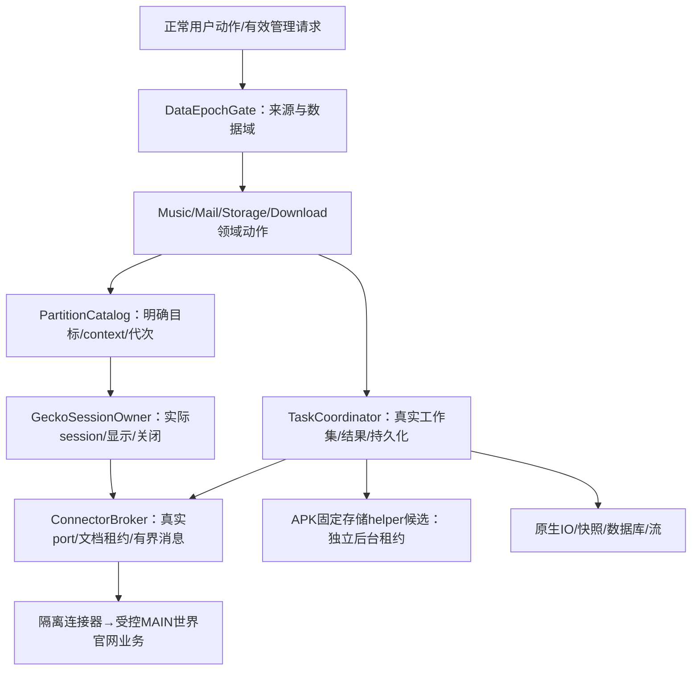
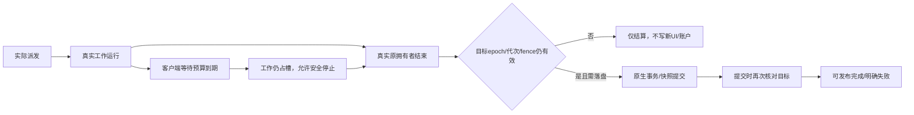

# 领域接口、连接器协议与任务时序 · R7

> 本轮把已有源码结论变成输入/输出、类型、状态与失败规则；不是产品类、扩展实现或SDK测试。

## 逻辑职责与执行所有权

| 唯一责任 | 权威接口记录 | 不能混为一谈 |
| --- | --- | --- |
| 数据源许可/目标归属 | DI01–DI02 | 认证成功≠能读被来源保护锁住的旧数据 |
| session/View/快照 | DI03、DI08 | detach≠inactive≠close；flush返回≠提交 |
| 握手/文档/消息流 | DI04 | Native sender和登记记录才是路由依据；payload自报不是身份 |
| 真实任务/取消/静默 | DI05 | UI超时≠工作结束；票据不能由调用者提交一个true伪造 |
| 音乐/邮件/下载/统计清理 | DI06–DI10 | 同领域服务供UI/管理员使用，不复制特权实现 |

[领域接口](../records/domain-interfaces.json)包含10个逻辑组件、45个方法的输入/输出/线程/所有权及能力覆盖。它们**不要求拆10个Gradle模块，也不是每个内部方法都开放成调试端点**；最终逐动作权限仍需绑定，不能照搬混合风险组的一个数字。

## 协议与背压

| 协议消息 | 关键语义 |
| --- | --- |
| HELLO→READY | 一次HELLO后等待；Native登记epoch/partition/session/document/port租约；页面不能自认管理员 |
| COMMAND→ACCEPTED→RESULT | 已接收不是已成功；一次选路；副作用未知不换路补发 |
| EVENT | 状态观测；不凭无requestId的媒体事件伪造精确ACK |
| CANCEL→CANCEL_STATUS | 请求/不支持/确认本地停止/未知分开；不承诺云端回滚 |
| STREAM_BEGIN→CREDIT→CHUNK→END | 先核准目的和总预算；有界信用；序号/长度/摘要后才提交领域数据 |
| ERROR | 类型化、脱敏；官网/系统等待、资源忙碌不得冒称权限不足 |

[协议权威记录](../records/connector-protocol.json)：单消息上限64KiB；原始块32KiB的base64为43692B，另留封装空间；信用窗64KiB。不再沿用“256KiB块但消息64KiB”的互相矛盾草案。大合法内容分块/落盘处理，不能将资源上限当权限不足。

| 通道 | 真实未完成上限 | 原则 |
| --- | --- | --- |
| auth | 1 | 相同账号检查合并，不叠加超时请求 |
| effect | 1 | 当前session实际副作用未结束不重复next/发送等 |
| read | 1 | 只替换尚未派发的旧读取；迟到结果只结算原工作 |
| safety | 1，另保留入口 | 暂停/停止/取消/关闭不能被挂起的登录/读取/播放Promise拖死 |

换端口/文档租约不重置真实工作预算；关闭页面也不等于helper扫描或native IO停止。安全停止仍校验权限/目标，但**不再追加fresh网页登录条件**；没有已拥有目标时不为“暂停”反而启动内核。

## 任务结果是多条轴，不是一个done

| 轴 | 典型状态 | 成功不能省略的检查 |
| --- | --- | --- |
| 执行 | queued/running/settled/owner-destroyed | 必须是实际拥有者，不是port断开 |
| 客户端 | waiting/deadline-exceeded/detached/result-available | 不决定是否释放底层槽 |
| 外部效果 | not-dispatched/observed/official-confirmed/possible/unknown | 关闭本地页面不证明副作用回滚 |
| 持久化 | not-required/pending/committed/failed/stale-discarded | 需要持久化的动作提交前不能发布成功 |

[参数/DTO/错误分类](../records/domain-payloads.json)和[动作语义](../records/action-semantics.json)明确绑定字段、单位、重试与完成证据；`current`在受授权接收时解析，不能排队后悄悄换到另一首歌/账户。

## 本轮可离线检查与尚不能证明的事

[29项时序例子](../records/runtime-traces.json)由[纯规划演算器](../review_runtime_design.py)检查：超时占槽、安全停止、错误拥有者结果、换代次、取消false、关闭页面不结束helper/IO、静默票据、原生提交前后及失败不发布。

这只证明**拟定规则与例子一致**，不证明Android、Gecko、官网或真实线程执行正确。仍需逐动作完整覆盖、流协议反例/fixture、页面world与Release样机实证；整体设计未完成。
