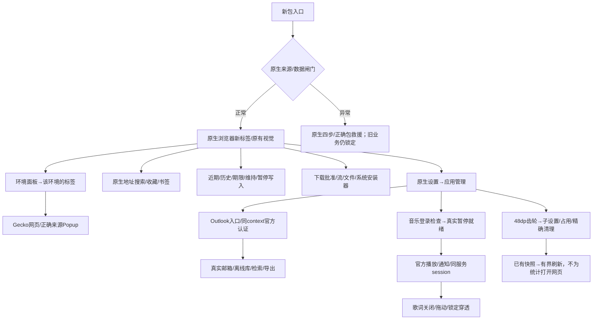

# 用户旅程、页面与返回路径 · A01／A03 · R7初稿

## 返回处理优先级

| 优先级 | 当前最高层 | Back语义 |
| --- | --- | --- |
| 1 | Android IME/系统选择器 | 系统正常处理输入法或选择器取消；结果必须回到原请求 |
| 2 | 本软件顶层模态/不可逆确认 | 取消/返回，不是默认同意；源异常流程退出仍保持业务锁定 |
| 3 | 页面全屏 | 真实退出全屏并同步原生窗口状态，不擅改系统旋转设置 |
| 4 | 原生抽屉/搜索建议/页面选择浮层 | 收起最高可关闭层，不误触网页跳转 |
| 5 | 子应用设置/离线详情/历史下载等次级屏幕 | 返回原父页和位置，不新造另一个业务会话 |
| 6 | 网页Popup | 先依其有效历史；无可返回层时关闭并回正确父session/partition |
| 7 | 当前网页历史 | 在同session返回；认证中间路径按实际官方流程处理，不重放登录 |
| 8 | 标签/环境/主应用根 | 按已有双层交互回父；明确退出UI不是停止合法音乐 |

每次只消费一次Back，不同时触发IME、网页history和Activity.finish。来源锁定壳没有旧网页栈；管理员发起的关闭/返回走同领域层，并受目标范围限制。

## 体验不回退的关键用例

| 旅程 | 必须保持/修正 | 不该发生 |
| --- | --- | --- |
| 首装新包 | 新身份/空数据/无v1迁移，浏览器和批准外观承接 | 自动卸旧包、清旧数据、抢默认浏览器 |
| 多环境/Popup | 同环境共享登录，不同环境隔离；Popup父来源明确 | 因View回收换错context、重复load或丢Popup |
| 邮件登录/恢复 | 个人/工作学校官方路径；最近成功入口；错误/网络未知有界恢复 | AadOrMsaRedirRequired就自动清Cookie，或无限切入口 |
| 离线阅读/检索 | 按需解压/有限缓存/可取消查询/安全内容呈现 | 为压缩静默删搜索功能，或把唯一正文当可重建缓存 |
| 音乐冷开/后台 | fresh业务准入＋真实暂停就绪；同session重连；明确起播 | 历史PLAYER快照自动播放、每回Activity都建第二个播放器 |
| 音乐暂停/焦点 | 认证未知也能停止已有播放；pause后旧gain不能恢复 | 停止按钮卡在fresh登录/旧未决Promise后面 |
| 子设置/占用 | 齿轮与入口启用、音源位置承接；先给已有部分数据再刷新 | 必须先进入网页才能看到占用，未知就禁用清理 |
| 清缓存/全部数据 | 精确目标；缓存与唯一内容分开；清理阶段如实显示 | 擅清其他子应用/公共文件，或退出页就假称任务已取消 |

[18条旅程矩阵](../matrices/user-journeys.csv)附入口、路径、返回/退出及管理员覆盖。所有行是设计场景，未实际跑新包。逐屏控件/手势/无障碍/小窗横竖屏对照和完整操作参数仍需补齐；这里不引入大UI框架、未修改原展示图或README。
