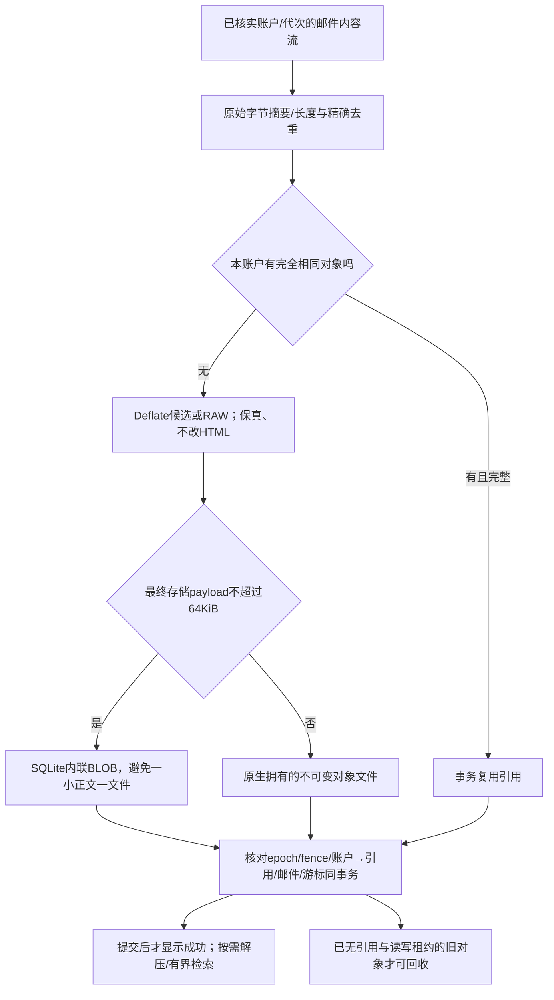

# 邮件存储落地方案与合成基线 · A07／R8

> 本轮运行了**仅主机、仅合成资料**的有界基准：11,618,156B生成内容，平台同格式Deflate/GZIP与主机已安装Zstd对照，逐记录压缩/解压原字节往返。没有读取真实邮箱、操作设备或加入产品依赖。单轮主机时间不能作为Android性能结论。

## 先决定存储布局，不能只追算法名

| 选择 | 理由／边界 |
| --- | --- |
| 每账户私有DB＋对象目录 | 不跨账户去重/引用/误删；先有官方账户绑定；新包无v1迁移 |
| 小payload内联，较大对象文件 | 不能为了压缩把2000封小邮件变成2000个小文件；64KiB为待Android验证的初始阈值 |
| RAW／zlib-Deflate两种初始格式 | 压后不够节省就RAW；GZIP多一层wrapper不是新能力；格式可版本化，不默认加第三方库 |
| Deflate9为大可压缩正文候选 | 低频允许较高写入成本，但9对6的收益不大；实机预算不合格应选6，不能为“等级高”锁死9 |
| 不默认引Zstd | 本次合成整体额外约3.93%、大HTML约8.46%；未证明Android依赖/ABI/维护成本值得。未来有代表性收益可重开 |
| 原始摘要先于压缩/加密 | 同账户精确去重；不是把随机密文重复存储后再压，也不是修改HTML换压缩率 |

## 主机基线实际结果

| 编码 | 混合样本payload（排除另列重复组） | 相对Deflate9额外节省 | 单轮主机编码时间，仅观察 |
| --- | ---: | ---: | ---: |
| Deflate6 | 4,674,895B | −0.27% | 约0.23s |
| Deflate9 | 4,662,420B | 基线 | 约0.35s |
| GZIP9 | 4,689,492B | −0.58% | 约0.35s |
| 已有主机Zstd3 | 4,652,910B | 0.20% | 约0.04s |
| 已有主机Zstd9 | 4,564,252B | 2.11% | 约0.17s |
| 已有主机Zstd19 | 4,479,184B | 3.93% | 约1.46s |

- 大HTML样本Deflate9约为原文27.7%–34.7%；本次小正文及高熵附件代理压缩后反而稍大，不能“所有内容都压”。
- 2000个小正文的**主机最小SQLite内容表**：RAW内联458,752B；全Deflate内联471,040B。未计真实邮件头/索引/加密/WAL，不能当正式数据库大小。
- 对照“一小文件至少4KiB”的模型为8,192,000B，**这是估算模型，不是Android文件系统实测**。
- 精确重复组96记录只24个独有内容；去重收益与算法收益单独列，不重复吹大压缩率。
- 所有编码逐条往返字节相同；这不验证崩溃恢复、加密、恶意解压或Android实现。

[完整原始结果/环境/脚本摘要](../evidence/mail-codec-host-baseline.json)；[可复现合成脚本](../experiments/mail_codec_baseline.py)使用标准库＋可选**既有主机**libzstd，未安装库。明确384MiB地址空间/60sCPU上限，新目录不覆盖已有资料；合成DB留仓库外。

## 实体、事务与占用口径

| 实体 | 关键约束 |
| --- | --- |
| account_meta | epoch/原生账户/partition/格式与绑定revision |
| mail_items | 官方item/revision、会话/日期/私有邮件头、body_ref；旧代次不可覆盖 |
| content_objects | 摘要、codec、原文/存储长度、INLINE/FILE二选一、完整性、引用数 |
| attachments | 官方附件key、明确拥有对象、状态/观察长度；名称/MIME不是路径或执行授权 |
| sync_state | 游标与邮件/对象引用同事务推进；游标是私有资料 |
| maintenance_jobs | 精确目标/阶段/epoch日志，恢复不重放未知云端副作用 |
| search_policy | 元数据快查、正文可取消；索引成本计入，不静默撤掉原有搜索 |

- 内联对象与引用可同SQLite事务提交；外部对象先完成写入/命名，再提交DB引用。失败保留旧修订；新孤儿只按保守GC规则处理。
- 引用数只是加速值；不确定就核对真实引用，不凭一个计数删对象；所有读写/任务租约结束前不回收。
- Native占用计DB/WAL/SHM、外部对象与自有临时文件；**内联payload已在DB内，不能再把stored_bytes加一次**。原文总长度另作逻辑指标，不冒充占用。
- 唯一离线正文/附件属于数据，不是普通可重建缓存。公开导出/云端资料不随本地缓存或来源保护流程删除。

[权威存储设计](../records/mail-storage-design.json)仍标明阻断项：完整SQL约束/故障fixture、Android性能/索引中文、加密帧/密钥恢复、安全阅读与恶意输入。**基线已运行不等于邮件产品已经实现或整个规划完成。**
